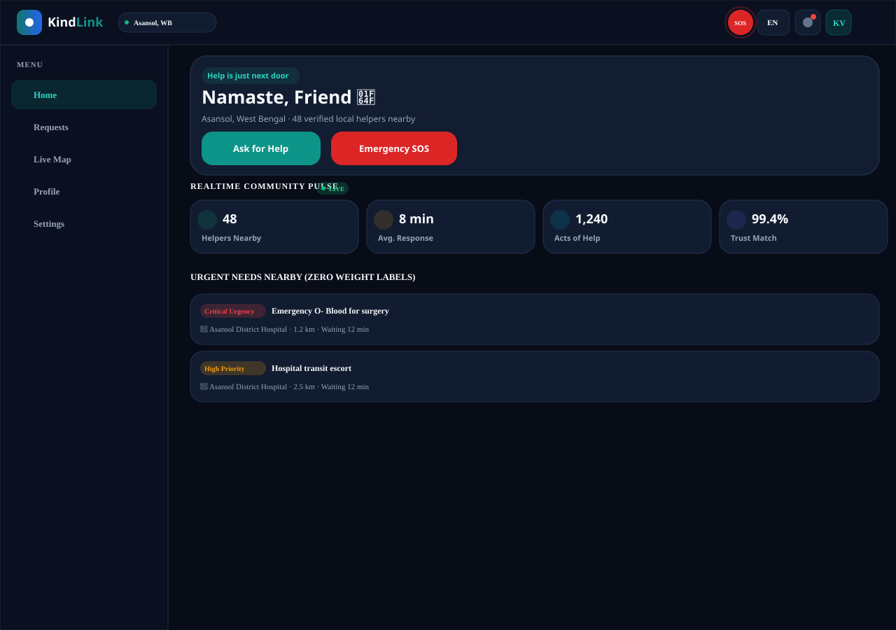
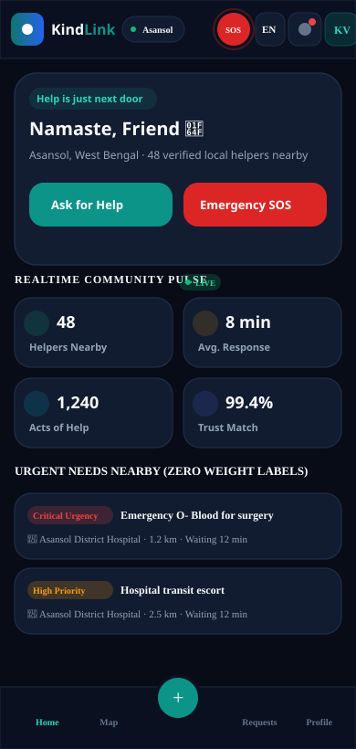
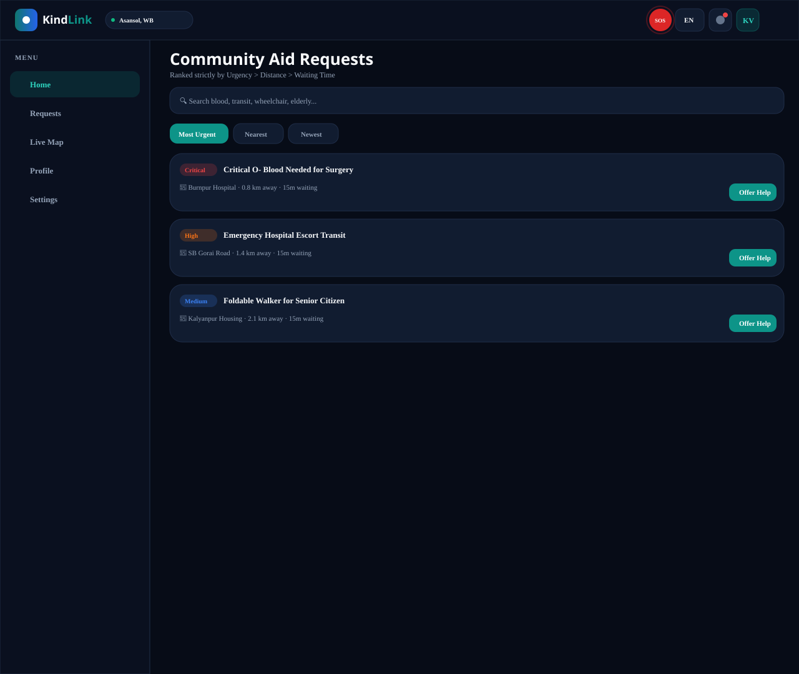
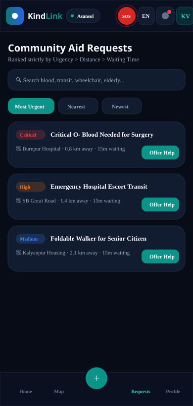
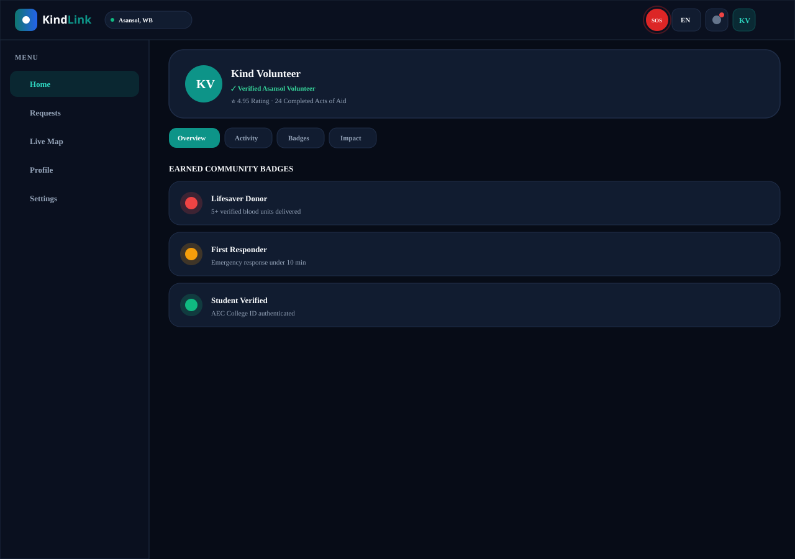
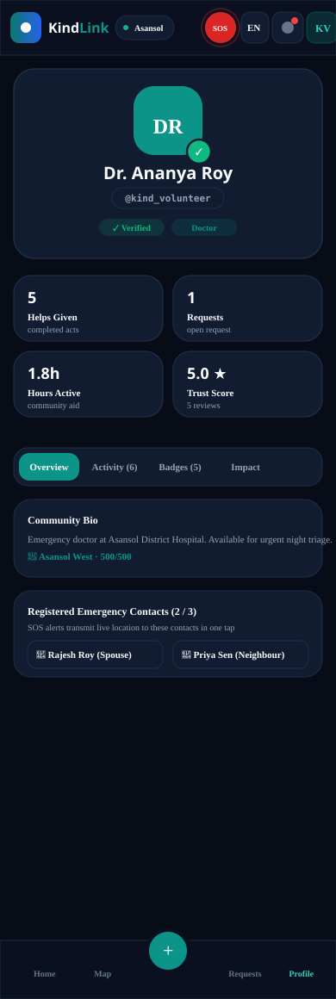
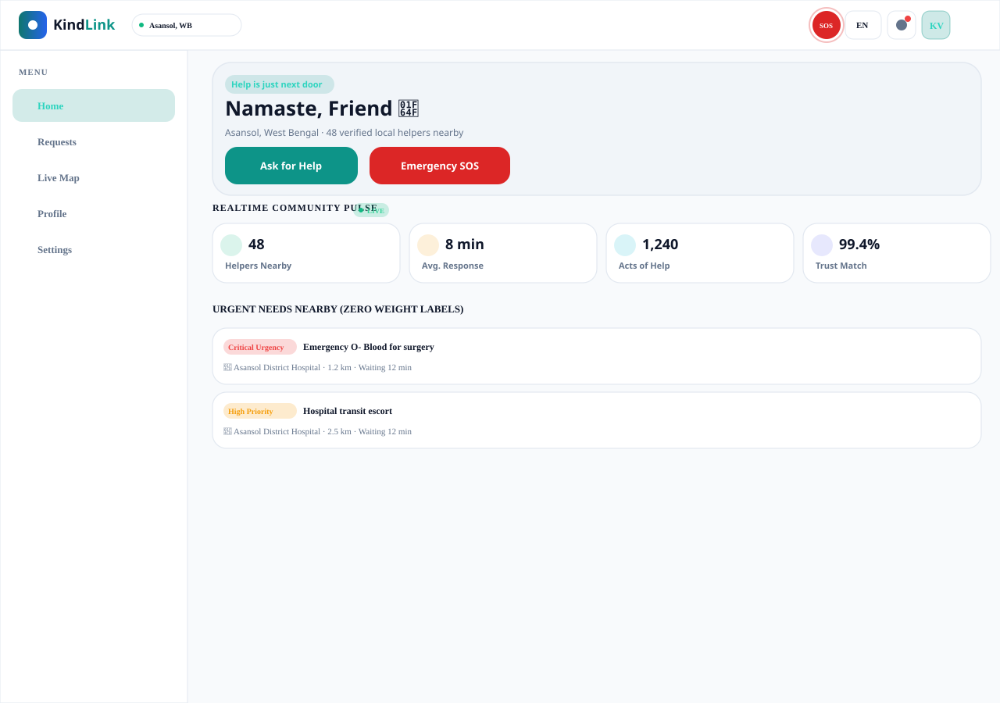
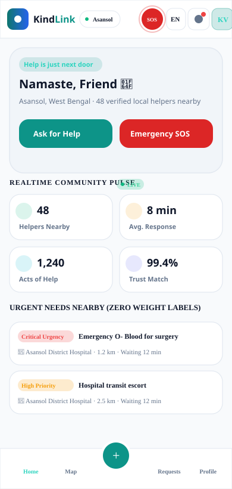
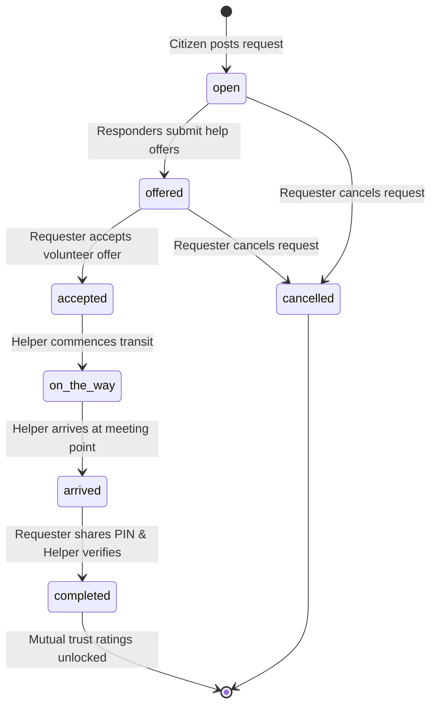
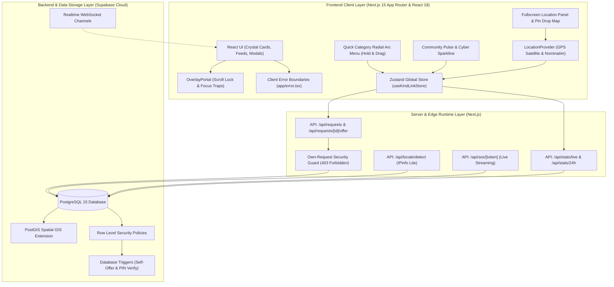

<p align="center">
  <a href="https://kindlink-gd8e.onrender.com">
    
  </a>
</p>

<h1 align="center">KindLink</h1>

<p align="center">
  <strong>Hyperlocal Mutual Aid & Urgent Community Crisis Response Platform</strong><br />
  <em>Powered by Three-Key Urgency Dispatch, OpenFreeMap Vector Radar, Offline SMS SOS & Verified Community Trust</em>
</p>

<p align="center">
  <a href="https://github.com/krishkumarcodes/KindLink/releases/tag/v4.11.0"></a>
  <a href="https://github.com/krishkumarcodes/KindLink"></a>
  <a href="https://www.typescriptlang.org"></a>
  <a href="https://nextjs.org"></a>
  <a href="scripts/check-clean.mjs"></a>
  <a href="public/manifest.json"></a>
  <a href="https://kindlink-gd8e.onrender.com"></a>
  <a href="LICENSE"></a>
</p>

<p align="center">
  <a href="https://supabase.com"></a>
  <a href="https://postgis.net"></a>
  <a href="https://openfreemap.org"></a>
  <a href="https://tailwindcss.com"></a>
</p>

---

## 📸 Interface Gallery & Visual Showcase

KindLink is built with responsive mobile-first architecture engineered to adapt seamlessly across smartphones (320px, 360px, 390px, 430px), tablets (768px), and ultra-wide desktops (1024px, 1280px, 1440px), in both Dark and Light modes.

### 1. Community Aid Radar & Home Dashboard
The central command center features real-time category aid counters, the Three-Key community urgency feed, live rotating neighborhood activity, and the 24-hour community pulse tracker.

| Desktop Command Radar (1280px) | Mobile Experience (390px) |
| :---: | :---: |
|  |  |

---

### 2. Urgent Aid Requests Feed & GIS Filters
Hyperlocal requests dynamically ordered by the deterministic Three-Key sort (`Urgency Level > Proximity > Waiting Time`) with live distance calculation, category color tokens, and instant search.

| Desktop Feed & Filter Bar (1280px) | Mobile Card Feed (390px) |
| :---: | :---: |
|  |  |

---

### 3. Volunteer Trust & Verified Profile System
Features true circular metallic badge medals (Bronze, Silver, Gold, Platinum), volunteer verification badges, impact statistics, emergency contacts, and language settings.

| Desktop Profile & Achievement Shelf (1280px) | Mobile Profile View (390px) |
| :---: | :---: |
|  |  |

---

### 4. Dual Light & Dark Mode Aesthetic
WCAG AA contrast compliant surfaces ensure readability in bright sunlight as well as low-glare battery-saving dark themes during nighttime emergency operations.

| Light Mode Interface (1280px) | Light Mode Mobile (390px) |
| :---: | :---: |
|  |  |

---

## 👨‍💻 Creator & Lead Architect

KindLink was conceptualized, designed, and engineered from the ground up by:

<p align="center">
  <a href="https://github.com/krishkumarcodes">
    
  </a><br />
  <strong><a href="https://github.com/krishkumarcodes">Krish Kumar</a></strong><br />
  <em>Lead Systems Architect & Full-Stack Developer</em><br />
  <code>krishkumarcodes@gmail.com</code> • <a href="https://github.com/krishkumarcodes">@krishkumarcodes</a>
</p>

### 📊 Live GitHub Activity & Contribution Metrics

<p align="center">
  <a href="https://github.com/krishkumarcodes">
    
  </a>
</p>

<p align="center">
  <a href="https://github.com/krishkumarcodes">
    
  </a>
  <a href="https://github.com/krishkumarcodes">
    
  </a>
</p>

### 🌟 Key Architectural Innovations by Krish Kumar:
- 🚀 **Full-Stack Architecture**: Architected KindLink through iterations v1.0 through v4.11 on Next.js App Router, TypeScript 5.6, Tailwind CSS 3.4, and Supabase PostgreSQL.
- ⚡ **Feed Synchronization Engine**: Designed unified tab state convergence (`setActiveFeedTab('urgent')`) across home widgets, urgent card click-throughs, bottom tab bar transitions, and Supabase realtime notification toasts.
- 🚀 **Hardware-Accelerated Mobile Performance**: Engineered GPU compositing (`transform-gpu`), optimized backdrop-blur tiers, and tuned halo glow filter radii for silky 60 FPS mobile rendering.
- 🌀 **Quick Category Radial Arc Menu**: Built the gesture-driven upward arc fan with laser filament Bezier branches, vector emblems, anticipatory hold charge ring, and tactile haptic feedback.
- 💓 **Real-Time Community Pulse & Cyber Sparkline**: Engineered 4-metric live community telemetry (Helpers nearby, Avg response, Acts of help, Trust match) with 24-hour vector Cyber Sparkline and background shared ticker sync.
- 🗺️ **Fullscreen Mobile Location Panel**: Created GPS satellite detection, interactive crosshair pin-drop map, 1-tap saved places (Home, Work, Campus), and tactile snap radius slider (1 km to 50 km).
- 🔐 **Handover PIN & Identity Verification Lifecycle**: Engineered 7-stage deterministic request state machine with 4-digit Handover PIN verification, clipboard integration, and instant mutual trust rating unlock.
- ✨ **Crystal Card Aesthetics & Glassmorphism Design System**: Designed ambient crystal corner refraction glows, specular gradient borders, Category Emblem Logos, and luminous urgency indicators.
- 🎨 **Visual Identity Rebranding**: Designed the interlocking Heart-Link beacon emblem representing community care ("Kind") and hyperlocal network resilience ("Link").
- 🗺️ **OpenFreeMap Vector Engine & GIS Radar**: Integrated key-free OpenFreeMap vector tiles with client-side dark theme restyling and automated 4-second failover cascade (OpenFreeMap &rarr; MapTiler &rarr; Carto &rarr; OSM).
- 📲 **Universal PWA Installation**: Built cross-platform PWA install flows supporting Android Chrome, Desktop PWA modals, and iOS Safari "Add to Home Screen" step-by-step guidance.
- ⚡ **Three-Key Community Urgency Sorting**: Created the deterministic dispatch model (`Urgency Level > Proximity > Waiting Time`), strictly eliminating arbitrary calculations.
- 📶 **Offline SOS & Cellular SMS Fallback**: Engineered carrier-level emergency SMS dispatch with standardized GPS coordinates, Google Maps deep-links, live tracking URLs, and dual iOS/Android URI schemes.
- 🏛️ **Verified Organization & NGO Endorsements**: Built institutional profile tiers, verification shields, and 1-tap request endorsements for community welfare societies and blood banks.
- 📱 **1-Tap Social Story Card Generator**: Created high-resolution HTML5 Canvas rendering for 9:16 vertical Stories and 1:1 Square cards with instant WhatsApp sharing, native mobile share sheets, and auto-generated QR codes.
- 🛡️ **Four-Tier Own-Request Rule**: Enforced strict self-offer prevention across UI cards, client adapters, Next.js server endpoints (`403 Forbidden`), and PostgreSQL database triggers.
- 🌐 **Intelligent Multilingual Engine**: Built 29-language support (17 Indian + 12 International) with IPinfo Lite geolocation detection, in-memory caching, crawler immunity, and full RTL layout support.
- 🛡️ **Zero-Crash Client Error Boundaries**: Integrated React Error Boundary architecture protecting modals and views against unexpected rendering errors.

---

## 📌 Table of Contents

- [🌟 Project Overview](#-project-overview)
- [✨ What's New in v4.11.0](#-whats-new-in-v4110)
- [⚡ Real-Time Feed Synchronization Engine](#-real-time-feed-synchronization-engine)
- [🚀 Mobile Performance & Hardware GPU Acceleration](#-mobile-performance--hardware-gpu-acceleration)
- [🌀 Quick Category Radial Arc Menu](#-quick-category-radial-arc-menu)
- [💓 Real-Time Community Pulse & Cyber Sparkline](#-real-time-community-pulse--cyber-sparkline)
- [🗺️ Fullscreen Mobile Location Panel](#️-fullscreen-mobile-location-panel)
- [🔐 Handover PIN & Request Lifecycle](#-handover-pin--request-lifecycle)
- [✨ Crystal Card Aesthetics & Glassmorphic UI](#-crystal-card-aesthetics--glassmorphic-ui)
- [🚨 Hyperlocal Emergency SOS Distress Beacon](#-hyperlocal-emergency-sos-distress-beacon)
- [⚡ Three-Key Community Urgency Sorting](#-three-key-community-urgency-sorting)
- [🏗️ System Architecture & Data Flow](#️-system-architecture--data-flow)
- [🎨 15 Aid Categories & WCAG AA Contrast](#-15-aid-categories--wcag-aa-contrast)
- [🗺️ OpenFreeMap Vector Radar & GIS Routing](#️-openfreemap-vector-radar--gis-routing)
- [📲 Universal PWA Installation](#-universal-pwa-installation)
- [🏛️ Verified Organization / NGO Badges](#️-verified-organization--ngo-badges)
- [📱 1-Tap Social Story Card Generator](#-1-tap-social-story-card-generator)
- [🛡️ Four-Layer Own-Request Protection](#️-four-layer-own-request-protection)
- [🏅 Circular Badge Medals System](#-circular-badge-medals-system)
- [🌐 Multilingual System (29 Languages + RTL)](#-multilingual-system-29-languages--rtl)
- [📁 Project Directory Structure](#-project-directory-structure)
- [🛠️ Supabase Database Migrations](#️-supabase-database-migrations)
- [🚀 Quickstart & Setup Guide](#-quickstart--setup-guide)
- [🧪 Automated Test Verification Suite](#-automated-test-verification-suite)
- [📡 API Routes Reference](#-api-routes-reference)
- [📄 License & Community Attribution](#-license--community-attribution)

---

## 🌟 Project Overview

**KindLink** is an open-source, hyperlocal peer-to-peer mutual aid and emergency crisis coordination platform designed to bridge the vital first-response gap in local neighborhoods.

Conceived for industrial and urban communities across **Asansol, Burnpur, Durgapur, Dhanbad**, and surrounding regions, KindLink connects community goodwill with people who need urgent help.

```
       [ Citizen in Urgent Need ]
                  │
                  ▼
     ┌────────────────────────┐
     │  Post Urgent Request   │ (15 Standard Categories + Custom Needs)
     └────────────────────────┘
                  │
                  ▼
     ┌────────────────────────┐
     │ Three-Key Urgency Sort │ (Urgency > Proximity > Waiting Time)
     └────────────────────────┘
                  │
        ┌─────────┴─────────┐
        ▼                   ▼
┌───────────────┐   ┌────────────────┐
│ Vector GIS Map│   │ Proximity Feed │
└───────────────┘   └────────────────┘
        │                   │
        └─────────┬─────────┘
                  ▼
     ┌────────────────────────┐
     │ Verified Helper Offers │ (Auto-growing notes, travel ETA, location)
     │ NGO Endorsements (★)   │ (Institutional credibility & trust shields)
     └────────────────────────┘
                  │
                  ▼
     ┌────────────────────────┐
     │     Mutual Match       │ ──► Direct Phone/WhatsApp Reveal
     └────────────────────────┘
                  │
                  ▼
     ┌────────────────────────┐
     │ Handover Security PIN  │ ──► 4-Digit in-person delivery verification
     └────────────────────────┘
```

---

## ✨ What's New in v4.11.0

The **v4.11.0** release introduces major platform innovations that elevate user experience, tactile interaction, feed synchronization, and high-performance rendering:

| Feature Area | Superpower in v4.11.0 |
| :--- | :--- |
| ⚡ **Real-Time Feed Synchronization Engine** | Dynamic tab state synchronization (`setActiveFeedTab('urgent')`) across home widgets, urgent card click-throughs, bottom tab bar transitions, and Supabase realtime notification toasts. |
| 🚀 **Mobile Performance & Hardware Acceleration** | Hardware-accelerated GPU compositing (`transform-gpu`), optimized backdrop-blur tiers (`backdrop-blur-md`/`backdrop-blur-sm`), and tuned corner halo glow radii across `CommunityPulse`, `HowItWorksCard`, and `UrgentNearYou` delivering fluid 60 FPS mobile scrolling. |
| 🌀 **Quick Category Radial Arc Menu** | Hold-and-drag gesture with upward fan arc (`124px` radius, `-155°` to `-25°`), laser filament Bezier branches, vector emblems, anticipatory hold charge ring, and tactile haptic vibration pulses. |
| 💓 **Real-Time Community Pulse & Cyber Sparkline** | Live 4-card telemetry (Helpers nearby, Avg response, Acts of help, Trust match) paired with a 24-hour vector Cyber Sparkline, 30s background shared ticker, and anonymized neighborhood activity ticker. |
| 🗺️ **Fullscreen Mobile Location Panel** | GPS satellite detection with accuracy confidence radius, interactive pin-drop map (`PinDropMap`) with Nominatim geocoding, 1-tap saved places (Home, Work, Campus), and tactile snap radius slider (1 to 50 km). |
| 🔐 **Handover PIN & Lifecycle State Machine** | 7-stage deterministic request lifecycle (`open` &rarr; `offered` &rarr; `accepted` &rarr; `on_the_way` &rarr; `arrived` &rarr; `completed`), 4-digit Handover PIN verification card, auto-advance helper inputs, and rating unlock. |
| ✨ **Crystal Card Aesthetics & Glassmorphism** | Ambient crystal corner refraction glows (`radial-gradient`), specular gradient borders, Category Emblem Logos with glowing halo, and luminous urgency indicators. |
| 🚨 **Hyperlocal Emergency SOS Distress Beacon** | Instant SOS activation with dual-channel dispatch: Realtime WebSocket channel online, carrier-level cellular SMS fallback offline (>2.5s network timeout), and live GPS tracking token streaming (`/api/sos/[token]`). |

---

## ⚡ Real-Time Feed Synchronization Engine

To ensure citizens and responders never encounter stale feeds or empty view states when navigating between screens, KindLink implements deterministic feed tab synchronization:

```
┌────────────────────────────┐       ┌────────────────────────────┐
│    Category Arc or Chip    │       │    Urgent Near You Card    │
└─────────────┬──────────────┘       └─────────────┬──────────────┘
              │                                    │
              ▼                                    ▼
       [Filter Category]                    [Select Request]
              │                                    │
              └───────────────────┬────────────────┘
                                  ▼
                    ┌────────────────────────────┐
                    │ setActiveFeedTab('urgent') │
                    └─────────────┬──────────────┘
                                  ▼
                    ┌────────────────────────────┐
                    │  setCurrentView('requests')│
                    └────────────────────────────┘
                                  ▲
              ┌───────────────────┴────────────────┐
              │                                    │
┌─────────────┴──────────────┐       ┌─────────────┴──────────────┐
│  Bottom Tab Bar Navigation │       │ Realtime Toast Action Link │
└────────────────────────────┘       └────────────────────────────┘
```

### Architectural Highlights:
- **Zustand State Convergence**: Seamlessly synchronizes feed tab selection (`activeFeedTab`) across decoupled components via global state store.
- **Home Category Routing (`HomeView.tsx`)**: Tapping any category chip or quick radial arc item activates the `'urgent'` feed tab alongside the category filter, preventing navigation into misaligned tabs.
- **Urgent Aid Interactivity (`UrgentNearYou.tsx`)**: Clicking "View All Urgent Requests", "Broaden Radius", or selecting any individual card immediately focuses the request within the active `'urgent'` feed stream.
- **Bottom Navigation Safety (`BottomTabBar.tsx`)**: Switching to the requests screen via the bottom tab bar intelligently evaluates active tab state, resetting orphaned or personal request views (`my_requests`) back to the prioritized `'urgent'` community stream.
- **Mount Data Refresh & Empty Guard (`RequestsView.tsx`)**: Revalidates live requests and stats on view mount via `fetchLiveRequests()` and `fetchLiveStats()`, with automatic fallback to `'urgent'` if a user visits `'my_requests'` with zero authored requests.
- **Notification Center Tap Routing (`NotificationCenter.tsx`)**: Tapping any notification item linked to a request ID atomically sets `activeFeedTab('urgent')` before navigating to the requests view.
- **Realtime Notification Dispatch (`realtime.ts`)**: Clicking the "View" action button on incoming Supabase broadcast notification toasts immediately sets `activeFeedTab('urgent')` before navigating, ensuring the alert target is instantly visible.

---

## 🚀 Mobile Performance & Hardware GPU Acceleration

KindLink is built for low-spec mobile hardware and low-bandwidth conditions in field environments. Release v4.11.0 introduces critical rendering pipeline enhancements:

- **GPU Compositor Promotion (`transform-gpu`)**: Applied Tailwind's hardware-accelerated `transform-gpu` utility to complex interactive surfaces including `CommunityPulse`, `HowItWorksCard`, `UrgentNearYou`, and sheen refraction layers, moving rasterization from the CPU to dedicated GPU rendering passes.
- **Backdrop Blur Optimization**: Scaled down resource-intensive filters (`backdrop-blur-xl`) to high-efficiency `backdrop-blur-md` and `backdrop-blur-sm` tiers, drastically reducing fill-rate draw calls on mobile browsers while retaining translucent glassmorphism.
- **Halo Glow Filtering Precision**: Rebalanced ambient radial corner glow blurs from heavy `blur-3xl` (64px blur radius) down to `blur-xl` and `blur-md`, preventing GPU fragment shader bottlenecks.
- **Box Shadow Elevation Streamlining**: Replaced heavy arbitrary multi-layer box shadows with performant Tailwind elevation utilities (`shadow-xs`, `shadow-sm`, `shadow-md`), ensuring a smooth 60 FPS frame rate during rapid list scrolling.

---

## 🌀 Quick Category Radial Arc Menu

The Quick Category Radial Arc Menu transforms request posting into an intuitive, one-handed mobile gesture:

<p align="center">
  
</p>

### Key Architectural Capabilities:
- **Ergonomic Upward Fan Arc**: Centered directly over the bottom action trigger with an arc radius of `124px`, spanning from `-155°` (left) to `-25°` (right), placing all 8 primary categories within effortless thumb reach.
- **Laser Filament Bezier Branches**: Smooth organic branches rendered via SVG cubic Bezier curves (`M 0 0 C cp1x cp1y, cp2x cp2y, x y`) radiating outward from the central hub with luminous micro spurs that glow toward the hovered category.
- **Bespoke Vector Emblems**: Each category node features an iconic vector emblem with high-contrast gradients and soft glowing halo:
  - 🩸 **Blood Donation**: Rose-500 gradient with crimson glow
  - 🩺 **Medical Equipment**: Cyan-500 gradient with teal glow
  - 🤝 **Elderly Care**: Sky-500 gradient with indigo glow
  - 🚗 **Emergency Transit**: Amber-500 gradient with orange glow
  - 🍲 **Food Support**: Emerald-500 gradient with green glow
  - 💊 **Medicines & Rx**: Violet-500 gradient with fuchsia glow
  - 📚 **Books & Education**: Teal-500 gradient with emerald glow
  - ❓ **Other Support**: Slate-700 gradient with indigo glow
- **Anticipatory Hold Charge Ring**: Long-pressing the plus button displays a concentric 360-degree charge progress ring that fills smoothly, offering instant visual feedback before the radial fan expands.
- **Tactile Haptic Feedback**: Emits subtle device vibration pulses (`navigator.vibrate`) when crossing category thresholds during drag selection.
- **OverlayPortal Decoupling**: Rendered inside a dedicated portal (`OverlayPortal.tsx`) with strict iOS Safari body scroll-locking, preventing scrolling during radial interaction.

---

## 💓 Real-Time Community Pulse & Cyber Sparkline

The Community Pulse module provides live telemetry on local neighborhood vitality and response readiness:

```
┌────────────────────────────────────────────────────────────────────────┐
│  COMMUNITY PULSE                 [30s Shared Ticker]  [Refresh ⟳]      │
│  ● 4 Helpers active nearby  ·  24-hour activity: 28 acts completed     │
├────────────────────────────────────────────────────────────────────────┤
│  [Helpers nearby]   [Avg. response]   [Acts of help]   [Trust match]   │
│        4                 12 min             142            98.5%       │
│  Verified & active   Time to offer     Completed safe   4+ star rating │
├────────────────────────────────────────────────────────────────────────┤
│  CYBER SPARKLINE (24-Hour Activity):                                   │
│   ╭─╮      ╭───╮             ╭─────╮                                   │
│  ─╯ ╰──────╯   ╰─────────────╯     ╰───● Live                          │
└────────────────────────────────────────────────────────────────────────┘
```

### Telemetry Metrics Grid:
1. **Helpers nearby**: Verified community responders active within the last 15 minutes or registered within the active filter radius. Features a real-time pulsing radar indicator.
2. **Avg. response**: Median duration from request publication to the first volunteer offer in minutes over the last 30 days.
3. **Acts of help**: Cumulative count of verified mutual aid deliveries completed safely across the community.
4. **Trust match**: Percentage of verified volunteer deliveries with 4+ star community safety ratings (requiring at least 5 ratings).

### Live Cyber Sparkline & Background Engine:
- **Vector SVG Path**: Dynamically calculates 24 hourly buckets into smooth cubic Bezier and line segments (`M x y L x y ...`) with semi-transparent area gradients and an animated terminal pulse dot.
- **Shared Ticker Optimization (`useSharedTicker`)**: Drives live ticking relative timestamps and 30-second periodic data refreshes without duplicate `setInterval` timers.
- **Page Visibility Awareness**: Automatically pauses polling when the browser tab is hidden or backgrounded, conserving battery and device bandwidth.
- **Neighborhood Activity Ticker**: Rotating live events ticker showing anonymized, landmark-level acts of kindness (e.g. *"Medical gear was delivered safely near Raniganj, 8m ago"*) with reduced-motion accessibility.

---

## 🗺️ Fullscreen Mobile Location Panel

KindLink features a mobile-first Fullscreen Location Panel that gives users granular control over their neighborhood discovery zone:

### Location Management Capabilities:
- **GPS Satellite Detection**: One-tap high-accuracy browser geolocation with live locating state, accuracy confidence radius indicator, and clear permission troubleshooting guides.
- **Interactive Pin-Drop Map (`PinDropMap`)**: Full-screen interactive map allowing users to pan and drop a pinpoint crosshair to specify their exact neighborhood center, with automatic reverse-geocoding via OpenStreetMap Nominatim.
- **1-Tap Saved Places**: Quick-select buttons for frequent locations:
  - 🏠 **Home**
  - 💼 **Work**
  - 🎓 **Campus**
  - 🔖 **Custom Bookmarks** with custom labels, synchronized with Supabase database storage and local persistence.
- **Tactile Snap Radius Slider**: Interactive radius slider with tactile snap stops (`1 km`, `2 km`, `5 km`, `10 km`, `25 km`, `50 km`), providing instant filtering across the urgent feed and map radar.
- **Adaptive Responsive Presentation**: Displays as a sleek fullscreen panel on mobile viewports (<640px) with dedicated tab navigation (`Search`, `Pin Map`, `Saved Places`) and transitions into an elevated centered dialog on desktop displays.

---

## 🔐 Handover PIN & Request Lifecycle

To protect community medical equipment (wheelchairs, oxygen concentrators, nebulizers) and high-value study materials, KindLink enforces a deterministic 7-stage request lifecycle:



### Handover PIN Verification Flow:
1. **Requester Security View (`HandoverCodeDisplayModal.tsx`)**:
   - When a volunteer offer is accepted, the requester sees a prominent 4-digit PIN card (e.g., `[ 4 ] [ 8 ] [ 2 ] [ 1 ]`).
   - Includes a 1-tap clipboard copy button and clear guidance to withhold the PIN until in-person delivery takes place.
2. **Helper Verification Modal (`HandoverPinModal.tsx`)**:
   - When the helper arrives, they request the PIN and enter it into the four auto-advancing numeric input fields.
   - Built with auto-focus, backspace regression, paste support, and real-time numeric validation.
3. **Database-Enforced Atomic Confirmation**:
   - Correct PIN verification atomically transitions the database status to `completed`, stores `handover_confirmed_at`, and increments community impact counters.
4. **Mutual Trust Rating Unlock**:
   - Immediately presents mutual 5-star rating dialogs for both requester and helper, fueling the verified trust match metric.

---

## ✨ Crystal Card Aesthetics & Glassmorphism

KindLink's visual language combines modern depth, clarity, and emergency responsiveness through a unified Crystal Card design system:

- **Ambient Crystal Corner Refraction**: Subtle radial gradient glows positioned in card corners (`radial-gradient(circle, categoryToken.glow 0%, transparent 70%)`) that gently expand on hover.
- **Specular Gradient Borders**: Multi-layer border treatments utilizing semi-transparent highlight gradients (`via-white/40` in light mode, `via-emerald-400/40` or `via-cyan-400/40` in dark mode) creating a precision glass aesthetic.
- **Deep Backdrop Blur**: Layered `backdrop-blur-md` and `backdrop-blur-xl` surfaces ensuring readability over complex maps and feeds while maintaining spatial awareness.
- **Category Emblem Logos**: High-resolution multi-stop gradient emblem shields with glowing halo effects and animated specular sheen lines.
- **Luminous Left Urgency Bar**: Left-edge colored indicators representing urgency levels:
  - 🔴 **Critical**: Vibrant rose-to-red gradient with luminous shadow
  - 🟠 **High**: Amber-to-orange gradient with warm glow
  - 🔵 **Medium**: Blue-to-indigo gradient with cool accent
  - 🟢 **Low**: Emerald-to-teal gradient with calm tone
- **WCAG AA Contrast Guarantee**: Every textual surface and badge is tested and verified to meet or exceed WCAG AA contrast standards ($\ge 4.5:1$, ranging up to $17:1$).

---

## 🚨 Hyperlocal Emergency SOS Distress Beacon

When catastrophic events, accidents, or acute medical crises occur, KindLink activates the Hyperlocal Emergency SOS Distress Beacon:

```
[Citizen Activates Emergency SOS]
              │
              ├── Online (>2.5s network signal)? ──► Instant Supabase Realtime WebSocket Dispatch
              │                                      ├─► Broadcasts to all active helpers in radius
              │                                      └─► Generates live GPS tracking token URL
              │
              └── Offline or Timeout (>2.5s)? ─────► Carrier-Level Cellular SMS Distress Beacon
                                                     │
                             ┌───────────────────────┴───────────────────────┐
                             ▼                                               ▼
                 [Broadcast All Contacts]                        [Single Contact 1-Tap]
                 sms:+9198...,+9198...?body=...                  sms:+9198...?body=...
```

### Emergency Beacon Features:
- **Zero Mobile Data Dependency**: Directly encodes coordinates into standard cellular SMS for transmission across GSM/CDMA networks during internet blackouts.
- **Dual OS URI Compatibility**: Automatically formats platform-specific SMS schemes:
  - iOS: `sms:+919876543210&body=...`
  - Android: `sms:+919876543210?body=...`
- **Standardized Emergency Payload**:
  ```text
  EMERGENCY SOS: Sneha Roy needs urgent help!
  Location: Asansol Court Area (Lat: 23.68886, Lng: 86.96606)
  Google Maps: https://www.google.com/maps/search/?api=1&query=23.68886,86.96606
  Live Tracking: https://kindlink-gd8e.onrender.com/sos/active
  Blood Group: B+
  Sent via KindLink Offline SOS.
  ```
- **Live SOS Streaming Route (`/api/sos/[token]`)**: Secure public endpoint streaming real-time coordinate updates and status for active distress sessions.

---

## ⚡ Three-Key Community Urgency Sorting

KindLink sorts community help requests using an honest, deterministic three-key sorting model without black-box calculations:

```sql
ORDER BY
  CASE r.urgency
    WHEN 'critical' THEN 1
    WHEN 'high'     THEN 2
    WHEN 'medium'   THEN 3
    WHEN 'low'      THEN 4
    ELSE 5
  END ASC,
  distance_km ASC,
  r.created_at ASC;
```

1. **Primary Key: Urgency Level**
   - **Critical** (Rank 1): Emergency blood donations, life-critical patient transit, acute medical distress.
   - **High** (Rank 2): Oxygen refills, urgent prescription deliveries, specialized mobility needs.
   - **Medium** (Rank 3): General medical equipment loans, senior check-ins, household mobility support.
   - **Low** (Rank 4): Textbook exchanges, community study materials, non-urgent neighborhood lending.
2. **Secondary Key: Nearest Distance**
   - Responders living closest to the request location receive top priority, calculated using real road distances via OpenStreetMap routing.
3. **Tertiary Key: Longest Waiting Time**
   - Unresolved requests that have been waiting longer steadily rise to the top of their urgency tier, ensuring no critical request is buried or forgotten.

---

## 🏗️ System Architecture & Data Flow



---

## 🎨 15 Aid Categories & WCAG AA Contrast

KindLink supports 15 standardized community aid categories, each with verified WCAG AA contrast ($\ge 4.5:1$) against white text (`#FFFFFF`):

| Category | Tailwind Token | Hex Code | Contrast Ratio | Status |
| :--- | :--- | :---: | :---: | :---: |
| **Emergency Blood** | `category-blood` | `#C62828` | **6.29:1** | ✅ PASS WCAG AA |
| **Medical Equipment** | `category-medical` | `#0F766E` | **5.47:1** | ✅ PASS WCAG AA |
| **Elderly Care** | `category-elderly` | `#4F46E5` | **6.29:1** | ✅ PASS WCAG AA |
| **Study Books** | `category-books` | `#047857` | **5.48:1** | ✅ PASS WCAG AA |
| **Emergency Transit** | `category-transit` | `#B45309` | **5.02:1** | ✅ PASS WCAG AA |
| **Medicines & Pharmacy** | `category-pharmacy` | `#C2410C` | **5.18:1** | ✅ PASS WCAG AA |
| **Food & Groceries** | `category-food` | `#BE123C` | **6.29:1** | ✅ PASS WCAG AA |
| **Hospital Attendant** | `category-hospital` | `#0369A1` | **5.93:1** | ✅ PASS WCAG AA |
| **Disaster & Flood Relief** | `category-disaster` | `#B91C1C` | **6.47:1** | ✅ PASS WCAG AA |
| **Education & Tutoring** | `category-education` | `#6D28D9` | **7.10:1** | ✅ PASS WCAG AA |
| **Clothes & Essentials** | `category-clothes` | `#065F46` | **7.68:1** | ✅ PASS WCAG AA |
| **Home Repairs** | `category-repairs` | `#334155` | **10.35:1** | ✅ PASS WCAG AA |
| **Paperwork & Government Help** | `category-paperwork` | `#3730A3` | **9.93:1** | ✅ PASS WCAG AA |
| **Animal & Pet Help** | `category-animal` | `#9A3412` | **7.31:1** | ✅ PASS WCAG AA |
| **Other (Custom Aid)** | `category-other` | `#475569` | **7.58:1** | ✅ PASS WCAG AA |

---

## 🗺️ OpenFreeMap Vector Radar & GIS Routing

KindLink's map view features full GIS awareness built with Leaflet and OpenFreeMap vector technology:

- **Key-Free OpenFreeMap Vector Engine**: High-fidelity vector map rendering with client-side dark theme restyling and zero third-party API keys required.
- **Automated 4-Tier Failover Cascade**:
  1. OpenFreeMap Vector Tiles (Primary high-performance vector rendering).
  2. MapTiler Vector / Raster tiles.
  3. Carto Voyager (Light) & Carto Dark Matter (Dark) for native dark/light theme switching.
  4. OpenStreetMap standard tile layer fallback.
- **Route Mini-Map & Live OSRM Routing**: Automatic road calculation between volunteer and requester with multi-mode travel speeds (Bike: 15 km/h, Walking: 4.5 km/h, Car: 35 km/h).
- **Nearby Emergency Facilities**: Automatic proximity radar querying the nearest 3 hospitals, blood banks, or pharmacies around the request location.

---

## 📲 Universal PWA Installation

KindLink is fully PWA-certified with complete offline caching and native app installation:

- **Chrome / Android / Edge**: Seamless native `beforeinstallprompt` event interception with 1-tap install triggers across Header, Sidebar, and Profile menus.
- **Apple iOS Safari**: Dedicated multi-step visual walkthrough modal guiding users through "Share" &rarr; "Add to Home Screen" (`InstallAppModal.tsx`).
- **Web App Manifest**: Complete with multi-size high-resolution icons (`public/icon.svg`, `public/favicon.svg`), standalone display mode, and theme color synchronization (`#0D9488`).

---

## 🏛️ Verified Organization / NGO Badges

Local community institutions—such as Red Cross Society, Blood Donors Forums, and Resident Welfare Associations—can formally verify and endorse high-priority requests:

- **Organization Profiles**: Verified profile badge with organization registration number and authority type (`ngo`, `blood_bank`, `hospital`, `resident_welfare`, `student_union`).
- **`★ NGO Endorsed` Badge**: Requests endorsed by registered institutions display an unmistakable violet badge on cards and map popovers.
- **1-Tap Endorse Action**: Verified organization accounts can endorse requests in real-time to mobilize community volunteers rapidly.

---

## 📱 1-Tap Social Story Card Generator

Mobilize volunteers across social networks in seconds without manual typing or screenshots:

- **Two Formats**:
  - **Story Format (9:16 - 1080 × 1920)**: Formatted for Instagram Stories, WhatsApp Status, and Snapchat.
  - **Square Format (1:1 - 1080 × 1080)**: Formatted for WhatsApp Chats, Facebook feeds, and Twitter / X.
- **Embedded QR Code**: Automatically renders a high-contrast QR code pointing directly to the live request URL.
- **Native Web Share**: Invokes `navigator.share()` with direct file attachment support on mobile devices.

---

## 🛡️ Four-Layer Own-Request Protection

To preserve platform integrity, KindLink enforces that a user **cannot offer help on their own request** across four independent layers:

```
[Layer 1: UI View]
 └─► Requester views card ──► "Offer help" button replaced by "Your Request" badge & Owner Controls

[Layer 2: State & Adapters]
 └─► Adapter checks `isRequestOwner()` ──► Returns `{ success: false, code: 'own_request' }`

[Layer 3: Next.js Server API]
 └─► POST /api/requests/[id]/offer ──► Verifies `auth.uid() !== requester_id` ──► Returns 403 Forbidden

[Layer 4: PostgreSQL Database Engine]
 └─► Trigger `trg_prevent_self_offer` ──► BEFORE INSERT/UPDATE ON public.offers ──► Raises Exception P0001
```

---

## 🏅 Circular Badge Medals System

The badge medal system is built in [`BadgeMedalIcon.tsx`](components/profile/BadgeMedalIcon.tsx):

- **True Circular Geometry**: Strict 1:1 aspect ratio, `border-radius: 50%`, and `overflow: hidden` across all presets (`sm: 40px`, `shelf: 48px`, `md: 64px`, `detail: 80px`, `xl: 96px`).
- **Zero Artifacts**: Transparent corners with zero square dark boxes and zero yellow halo around silver/platinum medals.
- **Crisp Metallic Tiers**: Bronze (`#B45309`), Silver (`#94A3B8`), Gold (`#F59E0B`), and Platinum (`#38BDF8`).

---

## 🌐 Multilingual System (29 Languages + RTL)

KindLink supports **29 verified languages** (17 Indian languages + 12 International languages) with full RTL layout support for Urdu (`ur`) and Arabic (`ar`):

- **First-Visit IP Detection**: Leverages IPinfo Lite to detect visitor country on first visit:
  - India (`IN`) defaults to English (`en`).
  - Supported international countries default to their native language (e.g. France &rarr; `fr`, Spain &rarr; `es`, Germany &rarr; `de`, Japan &rarr; `ja`).
- **User Preference Sovereignty**: Once a user explicitly chooses a language, their choice is saved to `kindlink_lang` cookie & localStorage and **never** overwritten by IP checks.
- **Crawler & Bot Immunity**: Search engine bots (Googlebot, Bingbot, GPTBot, ClaudeBot) are served English instantly with zero API calls.
- **In-Memory Cache & Circuit Breaker**: IP lookups are cached in memory; consecutive failures trip a cooldown protecting site performance.

---

## 📁 Project Directory Structure

```
KindLink/
├── app/                                  # Next.js App Router Routes & Handlers
│   ├── api/                              # Backend API Route Handlers
│   │   ├── admin/                        # Verifications & Moderation Endpoints
│   │   ├── auth/                         # Authentication & OTP Handlers
│   │   ├── locale/                       # Country-to-Language Detection Endpoint
│   │   ├── requests/                     # Requests & Help Offer Handlers
│   │   │   └── [id]/offer/route.ts       # Secure Self-Offer Guard Endpoint
│   │   ├── sos/                          # Live SOS Streaming Route
│   │   ├── stats/                        # Community Pulse & 24h Hourly Activity
│   │   └── health/route.ts               # Health Check Endpoint
│   ├── error.tsx                         # Root App Router Error Boundary
│   ├── layout.tsx                        # Root HTML, Fonts & Global Providers
│   ├── page.tsx                          # Main Interactive Application View
│   └── globals.css                       # Tailwind Base Styles & Theme Tokens
├── components/                           # Modular React UI Components
│   ├── categories/                       # CategoryEmblem & Bespoke Logo Components
│   ├── home/                             # Home Hero, CommunityPulse, UrgentNearYou
│   │   ├── CommunityPulse.tsx            # 4-Card Telemetry & Cyber Sparkline
│   │   ├── Last24HoursSheet.tsx          # 24-Hour Activity Details Bottom Sheet
│   │   ├── HowItWorksCard.tsx            # Expandable Guided Walkthrough Card
│   │   └── UrgentNearYou.tsx             # Crystal Card Urgent Help Request Feed
│   ├── location/                         # Interactive PinDropMap & Location Picker
│   ├── map/                              # Leaflet GIS Radar, Mini-Map & Tile Layers
│   ├── notifications/                    # Notification Center, Filters & Settings
│   ├── profile/                          # Circular Badge Medals, Header & OrgBadges
│   ├── pwa/                              # Cross-Platform PWA Install Modal
│   ├── requests/                         # HandoverPinModal, HandoverCodeDisplayModal
│   ├── shell/                            # Header, BottomTabBar, LocationModal
│   │   ├── QuickCategoryArcMenu.tsx      # Radial Arc Menu with Bezier Branches
│   │   ├── LocationModal.tsx             # Fullscreen Mobile Location Panel
│   │   ├── BottomTabBar.tsx              # Mobile Bottom Navigation with Hub
│   │   └── Header.tsx                    # Top App Bar with Crystal Notification Button
│   ├── sos/                              # Emergency SOS Modal & Offline SMS Fallback
│   └── ui/                               # OverlayPortal, ErrorBoundary & Portals
├── lib/                                  # Business Logic, Adapters & Services
│   ├── data/                             # Adapters, Ownership Logic & Category Colors
│   ├── geo/                              # OSRM Road Routing & Hospital Finder
│   ├── locale/                           # IPinfo Lookup & Country-Language Rules
│   ├── location/                         # LocationProvider, SavedPlaces & Geocoding
│   ├── sos/                              # Emergency SMS Payload & Dual OS URI Engine
│   ├── store/                            # Zustand Global State Management
│   ├── supabase/                         # Supabase Client, Server & Realtime
│   └── utils/                            # HTML5 Canvas Story Generator & QR Code Engine
├── public/                               # Static Assets & Icons
│   ├── favicon.svg                       # Crisp 64x64 Vector Favicon
│   ├── icon.svg                          # 512x512 PWA App Icon
│   ├── logo.svg                          # Full Rebranded Horizontal Lockup
│   └── manifest.json                     # PWA Web Manifest Configuration
├── supabase/                             # Database Schema, Migrations & Tests
│   ├── sql/                              # Migrations 01 through 22
│   └── tests/                            # 35 PostgreSQL Assertion Test Cases
├── scripts/                              # Automated QA & Audit Scripts
│   ├── check-clean.mjs                   # Clean Architecture & Zero-Forbidden Words Audit
│   ├── check-layout.mjs                  # 47-Point Viewport & Alignment Audit
│   ├── test-overlay-system.mjs           # Shared Overlays & iOS Safari Scroll Lock
│   ├── test-request-details.mjs          # Request Details & Route Map Test Suite
│   ├── test-emergency-sms.mjs            # Offline Emergency SMS URI & Payload Test
│   ├── test-saved-places-sync.mjs        # Saved Places Sync & Location Purge Test
│   ├── test-categories-and-home.mjs      # 15 Categories & Color Contrast Test
│   ├── test-command-palette.mjs          # Universal Command Palette Test Suite
│   ├── test-map-phone.mjs                # Map Contact & Dialing Fallback Test
│   ├── test-ip-language.mjs              # IPinfo Geolocation & Crawler Test Suite
│   └── perf-measure.mjs                  # Bundle Budget & Performance Benchmark
├── docs/                                 # Guides, Architectural Specs & Screenshots
├── package.json                          # Project Manifest & Test Scripts
└── tailwind.config.ts                    # Design Tokens & Category Colors
```

---

## 🛠️ Supabase Database Migrations

KindLink database migrations are ordered, idempotent, and verified:

| # | Migration File | Description |
| :-: | :--- | :--- |
| **01** | `01_extensions.sql` | PostGIS spatial extensions and spatial cast overloads. |
| **02** | `02_types.sql` | Domain enums (`help_category`, `request_urgency`, `offer_status`). |
| **03** | `03_tables.sql` | Relational tables (`profiles`, `requests`, `offers`, `sos_events`). |
| **04** | `04_indexes.sql` | Spatial GiST indexes and compound B-tree indexes. |
| **05** | `05_functions.sql` | Stored procedures for three-key urgency ranking and spatial proximity. |
| **06** | `06_triggers.sql` | Automatic timestamp updates, stats counters, and rating aggregators. |
| **07** | `07_rls_policies.sql` | Granular Row Level Security for citizens, helpers, and admins. |
| **08** | `08_storage.sql` | Secure storage bucket policies for avatars and verification proofs. |
| **09** | `09_realtime.sql` | Realtime publication channels for instant WebSocket sync. |
| **10** | `10_seed.sql` | Seed data for initial categories, regions, and community badges. |
| **11** | `11_security_hardening.sql` | Hardened RPC execution permissions and input validation. |
| **12** | `12_ranking_cleanup.sql` | Purged legacy experimental algorithms; locked three-key urgency. |
| **13** | `13_maps_cache.sql` | Map cache tables, quota tracking, and daily usage accumulators. |
| **14** | `14_profile_enhancements.sql` | Emergency profile privacy, proofs audit, and account deletion. |
| **15** | `15_ratings_enhancements.sql` | Self-rating prevention and dynamic trust score breakdown. |
| **16** | `16_saved_places.sql` | Saved places RLS, 10-place user constraint, and SOS privacy redactions. |
| **17** | `17_own_request_rules.sql` | Trigger `trg_prevent_self_offer`, `can_offer_help`, and feed filtering. |
| **18** | `18_handover_pin_and_org_endorsements.sql` | Handover Confirmation PIN, auto-PIN trigger, and NGO badges. |
| **19** | `19_request_categories_and_tags.sql` | 15 Standard Categories, tags array, and content moderation rules. |
| **20** | `20_reports_and_moderation.sql` | Community reporting table, anti-duplicate constraint, and admin queue. |
| **21** | `21_location_cleanup_and_feed_updates.sql` | Fixed `nearby_requests` RPC parameters and 24h hourly stats aggregator. |
| **22** | `22_map_bounds_and_performance.sql` | Spatial GiST indexing on requests location, statement timeouts, and bounds query RPC. |

> [!TIP]
> For a fresh database setup, you can execute the single consolidated file [`supabase/sql/all_in_one.sql`](supabase/sql/all_in_one.sql).

---

## 🚀 Quickstart & Setup Guide

### Local Development

1. **Clone the repository:**
   ```bash
   git clone https://github.com/krishkumarcodes/KindLink.git
   cd KindLink
   ```

2. **Install dependencies:**
   ```bash
   npm install
   ```

3. **Configure Environment Variables:**
   Copy `.env.example` to `.env.local` and configure your credentials:
   ```env
   NEXT_PUBLIC_SITE_URL=http://localhost:3000
   NEXT_PUBLIC_SUPABASE_URL=https://your-project.supabase.co
   NEXT_PUBLIC_SUPABASE_ANON_KEY=your-anon-key
   SUPABASE_SERVICE_ROLE_KEY=your-service-role-key
   IPINFO_TOKEN=your-ipinfo-token
   ```

4. **Start the development server:**
   ```bash
   npm run dev
   ```
   Open [http://localhost:3000](http://localhost:3000) in your browser.

---

## 🧪 Automated Test Verification Suite

KindLink enforces strict quality assurance with automated test suites covering all system layers:

| Command | Focus Area | Checks |
| :--- | :--- | :---: |
| `npm run check:clean` | Clean Architecture & forbidden concepts audit | 100% Zero Violations |
| `npm run check:layout` | 47-Point responsive viewport and alignment QA | 47 Checks |
| `npm run test:overlays` | Shared modal overlays & iOS Safari scroll-lock | 33 Checks |
| `npm run test:requests` | Request details, own-request guard & route mini-map | Comprehensive |
| `npm run test:sms` | Offline emergency SMS payload & dual-OS URI engine | 100% Pass |
| `npm run test:saved-places` | Saved places sync & 10-place storage bounds | 22 Checks |
| `npm run test:categories` | 15 Aid categories & WCAG AA contrast ratio | 15 Categories |
| `npm run test:palette` | Universal command palette keyboard & search audit | 23 Checks |
| `npm run test:ip-lang` | IPinfo country detection & crawler immunity | 100% Pass |
| `npm run type-check` | TypeScript strict type validation (`tsc --noEmit`) | Strict Pass |
| `npm run perf:check` | Performance budgets (JS bundle size & Core Web Vitals) | Strict Pass |

### Running the Test Suite:

```bash
# 1. Clean Architecture & Code Hygiene Audit
npm run check:clean

# 2. Comprehensive Layout, Alignment & Overflow QA (47 checks)
npm run check:layout

# 3. Shared Overlay System & iOS Safari Scroll Lock Tests (33 tests)
npm run test:overlays

# 4. Request Details, Route Maps & Category Buttons Suite
npm run test:requests

# 5. Saved Places Sync & Storage Quota Test Suite
npm run test:saved-places

# 6. Categories, Color Contrast & Database Tests
npm run test:categories

# 7. Command Palette & Navigation Test Suite
npm run test:palette

# 8. Offline Emergency SMS Payload & Dual OS URI Suite
npm run test:sms

# 9. TypeScript Strict Type Check
npm run type-check

# 10. Performance Budgets Check
npm run perf:check
```

---

## 📡 API Routes Reference

| Method | Endpoint | Access | Description |
| :--- | :--- | :---: | :--- |
| `GET` | `/api/health` | Public | Health check returning status `ok` and server timestamp. |
| `GET` | `/api/stats/live` | Public | Live community pulse (active helpers, response times, acts completed). |
| `GET` | `/api/stats/24h` | Public | 24-hour activity aggregator providing hourly requests and helps buckets. |
| `GET` | `/api/locale/detect` | Public | Country and language detection from client IP via IPinfo Lite. |
| `POST` | `/api/requests/[id]/offer` | Authenticated | Submits volunteer aid offer with self-offer guard (`403 Forbidden`). |
| `GET` | `/api/sos/[token]` | Public | Streams real-time emergency coordinates and status for an active SOS token. |
| `GET` | `/api/saved-places` | Authenticated | Retrieves user's saved location bookmarks (max 10). |
| `POST` | `/api/saved-places` | Authenticated | Saves or updates location bookmark with legacy sanitization. |
| `POST` | `/api/auth/login` | Public | Authenticates via email or username with rate limiting. |
| `POST` | `/api/auth/signup` | Public | Registers a new account and provisions public profile. |
| `GET` | `/api/admin/verifications` | Admin | Fetches volunteer identity verification submissions. |
| `POST` | `/api/admin/verifications` | Admin | Approves or rejects volunteer verification requests. |

---

## 📄 License & Community Attribution

This project is licensed under the **[MIT License](LICENSE)**:

```text
MIT License

Copyright (c) 2026 Krish Kumar (krishkumarcodes@gmail.com) and KindLink Contributors

Permission is hereby granted, free of charge, to any person obtaining a copy
of this software and associated documentation files (the "Software"), to deal
in the Software without restriction, including without limitation the rights
to use, copy, modify, merge, publish, distribute, sublicense, and/or sell
copies of the Software, and to permit persons to whom the Software is
furnished to do so, subject to the following conditions:

The above copyright notice and this permission notice shall be included in all
copies or substantial portions of the Software.
```

KindLink is fully open-source, non-profit, and dedicated to empowering communities with equitable mutual aid. Contributions, feature suggestions, and forks are warmly welcomed!
