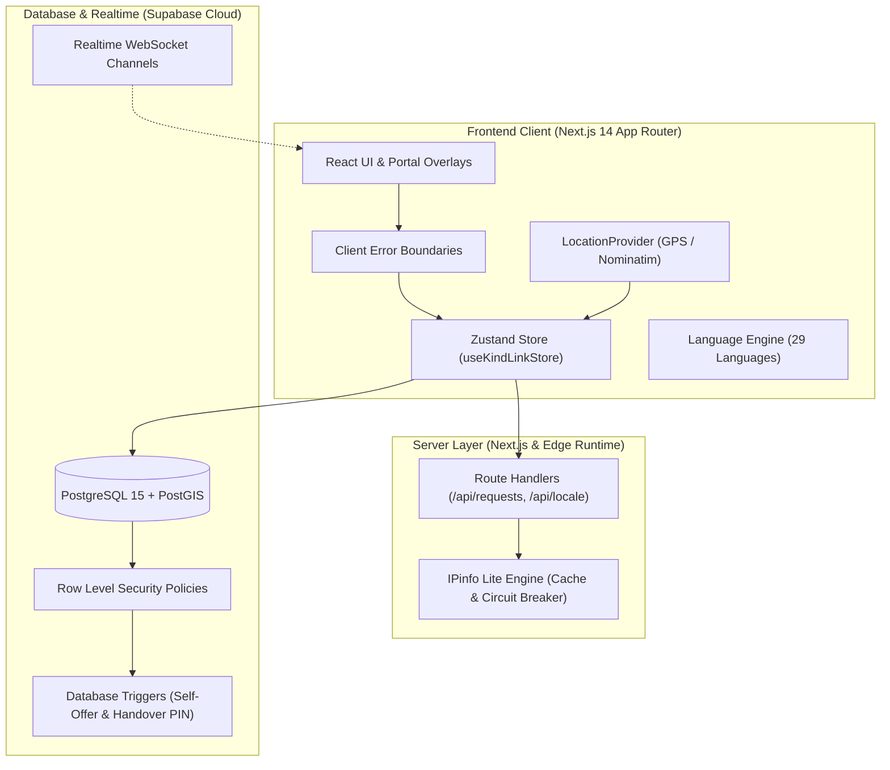

<p align="center">
  <a href="https://kindlink-gd8e.onrender.com">
    
  </a>
</p>

<h1 align="center">KindLink</h1>

<p align="center">
  <strong>Hyperlocal Mutual Aid & Urgent Community Crisis Response Platform</strong><br />
  <em>Powered by Three-Key Urgency Dispatch, OpenFreeMap Vector Radar, Offline SMS SOS & Verified Community Trust</em>
</p>

<p align="center">
  <a href="https://github.com/krishkumarcodes/KindLink/releases/tag/v4.8.2"></a>
  <a href="https://kindlink-gd8e.onrender.com"></a>
  <a href="https://nextjs.org"></a>
  <a href="https://www.typescriptlang.org"></a>
  <a href="https://supabase.com"></a>
  <a href="https://postgis.net"></a>
  <a href="https://openfreemap.org"></a>
  <a href="https://tailwindcss.com"></a>
  <a href="https://web.dev/explore/progressive-web-apps"></a>
  <a href="LICENSE"></a>
</p>

---

## 📸 Interface Gallery & Visual Showcase

KindLink is built with responsive mobile-first architecture engineered to adapt seamlessly across smartphones (320px, 360px, 390px, 430px), tablets (768px), and ultra-wide desktops (1024px, 1280px, 1440px), in both Dark and Light modes.

### 1. Community Aid Radar & Home Dashboard
The central command center features real-time category aid counters, the Three-Key community urgency feed, live rotating neighborhood activity, and the 24-hour community pulse tracker.

| Desktop Command Radar (1280px) | Mobile Experience (390px) |
| :---: | :---: |
|  |  |

---

### 2. Urgent Aid Requests Feed & GIS Filters
Hyperlocal requests dynamically ordered by the deterministic Three-Key sort (`Urgency Level > Proximity > Waiting Time`) with live distance calculation, category color tokens, and instant search.

| Desktop Feed & Filter Bar (1280px) | Mobile Card Feed (390px) |
| :---: | :---: |
|  |  |

---

### 3. Volunteer Trust & Verified Profile System
Features true circular metallic badge medals (Bronze, Silver, Gold, Platinum), volunteer verification badges, impact statistics, emergency contacts, and language settings.

| Desktop Profile & Achievement Shelf (1280px) | Mobile Profile View (390px) |
| :---: | :---: |
|  |  |

---

### 4. Dual Light & Dark Mode Aesthetic
WCAG AA contrast compliant surfaces ensure readability in bright sunlight as well as low-glare battery-saving dark themes during nighttime emergency operations.

| Light Mode Interface (1280px) | Light Mode Mobile (390px) |
| :---: | :---: |
|  |  |

---

## 👨‍💻 Creator & Lead Architect

KindLink was conceptualized, designed, and engineered from the ground up by:

<p align="center">
  <a href="https://github.com/krishkumarcodes">
    
  </a><br />
  <strong><a href="https://github.com/krishkumarcodes">Krish Kumar</a></strong><br />
  <em>Lead Systems Architect & Full-Stack Developer</em><br />
  <code>krishkumarcodes@gmail.com</code> • <a href="https://github.com/krishkumarcodes">@krishkumarcodes</a>
</p>

### 📊 Live GitHub Activity & Contribution Metrics

<p align="center">
  <a href="https://github.com/krishkumarcodes">
    
  </a>
</p>

<p align="center">
  <a href="https://github.com/krishkumarcodes">
    
  </a>
  <a href="https://github.com/krishkumarcodes">
    
  </a>
</p>

### 🌟 Key Contributions by Krish Kumar:
- 🚀 **Full-Stack Architecture**: Architected KindLink through iterations v1.0 through v4.8.2 on Next.js 14 App Router, TypeScript 5.6, Tailwind CSS 3.4, and Supabase PostgreSQL.
- 🎨 **Visual Identity Rebranding**: Designed the new interlocking Heart-Link beacon emblem representing community care ("Kind") and hyperlocal network resilience ("Link").
- 🗺️ **OpenFreeMap Vector Engine & GIS Radar**: Integrated key-free OpenFreeMap vector tiles with client-side dark theme restyling and automated 4-second failover cascade (OpenFreeMap &rarr; MapTiler &rarr; Carto &rarr; OSM).
- 📲 **Universal PWA Installation**: Built cross-platform PWA install flows supporting Android Chrome, Desktop PWA modals, and iOS Safari "Add to Home Screen" step-by-step guidance.
- ⚡ **Three-Key Community Urgency Sorting**: Created the deterministic dispatch model (`Urgency Level > Proximity > Waiting Time`), strictly eliminating arbitrary calculations.
- 📶 **Offline SOS & Cellular SMS Fallback**: Engineered carrier-level emergency SMS dispatch with standardized GPS coordinates, Google Maps deep-links, live tracking URLs, and dual iOS/Android URL schemes.
- 🔐 **4-Digit Handover Confirmation PIN**: Designed physical exchange verification for medical gear loans and textbooks with requester PIN cards, clipboard copy, and auto-focus helper modals.
- 🏛️ **Verified Organization & NGO Endorsements**: Built institutional profile tiers, verification shields, and 1-tap request endorsements for community welfare societies and blood banks.
- 📱 **1-Tap Social Story Card Generator**: Created high-resolution HTML5 Canvas rendering for 9:16 vertical Stories and 1:1 Square cards with instant WhatsApp sharing, native mobile share sheets, and auto-generated QR codes.
- 🛡️ **Four-Tier Own-Request Rule**: Enforced strict self-offer prevention across UI cards, client adapters, Next.js server endpoints (`403 Forbidden`), and PostgreSQL database triggers.
- 🌐 **Intelligent Multilingual Engine**: Built 29-language support (17 Indian + 12 International) with IPinfo Lite geolocation detection, in-memory caching, crawler immunity, and full RTL layout support.
- 🛡️ **Zero-Crash Client Error Boundaries**: Integrated React Error Boundary architecture protecting modals and views against unexpected rendering errors.

---

## 📌 Table of Contents

- [🌟 Project Overview](#-project-overview)
- [✨ What's New in v4.8.2](#-whats-new-in-v482)
- [🎨 Rebranded Visual Identity](#-rebranded-visual-identity)
- [⚡ Three-Key Community Urgency Sorting](#-three-key-community-urgency-sorting)
- [🗺️ OpenFreeMap Vector Radar & GIS Routing](#️-openfreemap-vector-radar--gis-routing)
- [📲 Universal PWA Installation](#-universal-pwa-installation)
- [📶 Offline SOS & Cellular SMS Fallback](#-offline-sos--cellular-sms-fallback)
- [🔐 4-Digit Handover Confirmation PIN](#-4-digit-handover-confirmation-pin)
- [🏛️ Verified Organization / NGO Badges](#️-verified-organization--ngo-badges)
- [📱 1-Tap Social Story Card Generator](#-1-tap-social-story-card-generator)
- [🛡️ Four-Layer Own-Request Protection](#️-four-layer-own-request-protection)
- [🎨 15 Aid Categories & WCAG AA Contrast](#-15-aid-categories--wcag-aa-contrast)
- [🏅 Circular Badge Medals System](#-circular-badge-medals-system)
- [🌐 Multilingual System (29 Languages + RTL)](#-multilingual-system-29-languages--rtl)
- [🏗️ System Architecture & Data Flow](#️-system-architecture--data-flow)
- [📁 Project Directory Structure](#-project-directory-structure)
- [🛠️ Supabase Database Migrations](#️-supabase-database-migrations)
- [🚀 Quickstart & Setup Guide](#-quickstart--setup-guide)
- [🧪 Automated Test Verification Suite](#-automated-test-verification-suite)
- [📡 API Routes Reference](#-api-routes-reference)
- [📄 License & Community Attribution](#-license--community-attribution)

---

## 🌟 Project Overview

**KindLink** is an open-source, hyperlocal peer-to-peer mutual aid and emergency crisis coordination platform designed to bridge the vital first-response gap in local neighborhoods.

Conceived for industrial and urban communities across **Asansol, Burnpur, Durgapur, Dhanbad**, and surrounding regions, KindLink connects community goodwill with people who need urgent help.

```
       [ Citizen in Urgent Need ]
                  │
                  ▼
     ┌────────────────────────┐
     │  Post Urgent Request   │ (15 Standard Categories + Custom Needs)
     └────────────────────────┘
                  │
                  ▼
     ┌────────────────────────┐
     │ Three-Key Urgency Sort │ (Urgency > Proximity > Waiting Time)
     └────────────────────────┘
                  │
        ┌─────────┴─────────┐
        ▼                   ▼
┌───────────────┐   ┌────────────────┐
│ Vector GIS Map│   │ Proximity Feed │
└───────────────┘   └────────────────┘
        │                   │
        └─────────┬─────────┘
                  ▼
     ┌────────────────────────┐
     │ Verified Helper Offers │ (Auto-growing notes, travel ETA, location)
     │ NGO Endorsements (★)   │ (Institutional credibility & trust shields)
     └────────────────────────┘
                  │
                  ▼
     ┌────────────────────────┐
     │     Mutual Match       │ ──► Direct Phone/WhatsApp Reveal
     └────────────────────────┘
                  │
                  ▼
     ┌────────────────────────┐
     │  Handover Security PIN │ ──► 4-Digit physical exchange verification
     └────────────────────────┘
```

---

## ✨ What's New in v4.8.2

The **v4.8.2** release introduces critical stability enhancements, visual rebranding, and performance optimizations:

| Feature Area | Superpower in v4.8.2 |
| :--- | :--- |
| 🎨 **Rebranded Visual Identity** | All-new modern logo lockup (`public/logo.svg`), 512x512 adaptive PWA app icon (`public/icon.svg`, `app/icon.svg`), and crisp browser favicon (`public/favicon.svg`) featuring the interlocking Heart-Link beacon emblem. |
| 🛡️ **Zero-Crash Error Boundaries** | Created reusable [`<ErrorBoundary>`](components/ui/ErrorBoundary.tsx) and root [`app/error.tsx`](app/error.tsx), fully preventing client-side exception crashes when managing active requests or opening modals. |
| 📲 **Universal PWA Installation** | High-visibility install app buttons in Header, Sidebar, and Mobile Menu with native `beforeinstallprompt` binding and custom iOS Safari walkthrough modal. |
| 🗺️ **OpenFreeMap Vector Tiles** | Zero-API-key vector GIS map engine with dynamic client-side dark theme restyling and automated 4-tier failover cascade (OpenFreeMap &rarr; MapTiler &rarr; Carto &rarr; OSM). |
| 🔔 **Persistent Notification Center** | Realtime notification center with persistent delete/clear actions, unread indicators, and 5-category filter pills. |
| 📋 **Active Requests Management** | Seamless one-tap "Manage" flow directly from the Home view active requests strip, linking into the request details modal with real-time volunteer offers and PIN controls. |

---

## 🎨 Rebranded Visual Identity

KindLink's visual identity unites compassion and connectivity into a singular, memorable emblem:

<p align="center">
  
</p>

- **The Squircle Base**: Elevated glassmorphic squircle with dual-layer 1px glass border, gradient lighting (`#0F766E` &rarr; `#0D9488` &rarr; `#06B6D4` &rarr; `#2563EB`).
- **The Heart-Link Ribbon**: Seamless interlocking vector merging the soft curves of a caring heart ("Kind") with an infinite community node loop ("Link").
- **The Emergency Core Beacon**: Radial amber-rose gold pulse (`#FEF08A` &rarr; `#F59E0B` &rarr; `#EF4444`) with an inner white center point representing real-time crisis dispatch.
- **Concentric Radar Orbitals**: Ultra-fine orbital rings illustrating neighborhood proximity reach.
- **Adaptive Contrast**: Dynamic dark/light mode wordmark styling ensuring crisp legibility on any surface.

---

## ⚡ Three-Key Community Urgency Sorting

KindLink sorts community help requests using an honest, deterministic three-key sorting model without black-box score calculations:

```sql
ORDER BY
  CASE r.urgency
    WHEN 'critical' THEN 1
    WHEN 'high'     THEN 2
    WHEN 'medium'   THEN 3
    WHEN 'low'      THEN 4
    ELSE 5
  END ASC,
  distance_km ASC,
  r.created_at ASC;
```

1. **Primary Key: Urgency Level**
   - **Critical** (Rank 1): Emergency blood donations, life-critical patient transit, acute medical distress.
   - **High** (Rank 2): Oxygen refills, urgent prescription deliveries, specialized mobility needs.
   - **Medium** (Rank 3): General medical equipment loans, senior check-ins, household mobility support.
   - **Low** (Rank 4): Textbook exchanges, community study materials, non-urgent neighborhood lending.
2. **Secondary Key: Nearest Distance**
   - Responders living closest to the request location receive top priority. Calculated using real road distances via OpenStreetMap road routing.
3. **Tertiary Key: Longest Waiting Time**
   - Unresolved requests that have been waiting longer steadily rise to the top of their urgency tier, ensuring no critical request is buried or forgotten.

---

## 🗺️ OpenFreeMap Vector Radar & GIS Routing

KindLink's map view features full GIS awareness built with Leaflet and OpenFreeMap vector technology:

- **Key-Free OpenFreeMap Vector Engine**: High-fidelity vector map rendering with client-side dark theme restyling and zero third-party API keys required.
- **Automated 4-Tier Failover Cascade**:
  1. OpenFreeMap Vector Tiles (Primary high-performance vector rendering).
  2. MapTiler Vector / Raster tiles.
  3. Carto Voyager (Light) & Carto Dark Matter (Dark) for native dark/light theme switching.
  4. OpenStreetMap standard tile layer fallback.
- **Route Mini-Map & Live OSRM Routing**: Automatic road calculation between volunteer and requester with multi-mode travel speeds (Bike: 15 km/h, Walking: 4.5 km/h, Car: 35 km/h).
- **Nearby Emergency Facilities**: Automatic proximity radar querying the nearest 3 hospitals, blood banks, or pharmacies around the request location.

---

## 📲 Universal PWA Installation

KindLink is fully PWA-certified with complete offline caching and native app installation:

- **Chrome / Android / Edge**: Seamless native `beforeinstallprompt` event interception with 1-tap install triggers across Header, Sidebar, and Profile menus.
- **Apple iOS Safari**: Dedicated multi-step visual walkthrough modal guiding users through "Share" &rarr; "Add to Home Screen" (`InstallAppModal.tsx`).
- **Web App Manifest**: Complete with multi-size high-resolution icons (`public/icon.svg`, `public/favicon.svg`), standalone display mode, and theme color synchronization (`#0D9488`).

---

## 📶 Offline SOS & Cellular SMS Fallback

When natural disasters, accidents, or network blackouts strike, KindLink falls back to **Carrier-Level Offline SOS**:

```
[Emergency SOS Activated]
         │
         ├── Online (>2.5s signal)? ────► Cloud Dispatch to Supabase Realtime
         │
         └── Offline or Timeout (>2.5s)? ──► Pulsing Offline SMS Mode
                                                  │
                ┌─────────────────────────────────┴─────────────────────────────────┐
                ▼                                                                   ▼
    [Send to All Contacts]                                              [Single Contact 1-Tap]
   sms:+9198...,+9198...?body=...                                      sms:+9198...?body=...
```

- **Zero Mobile Data Required**: Dispatches emergency coordinates via standard cellular SMS over GSM/CDMA networks.
- **Cross-Platform Compatibility**: Automatically detects iOS vs Android to format proper URI query parameters (`sms:+91...?body=` vs `sms:+91...&body=`).
- **Standardized Emergency Payload**:
  ```text
  EMERGENCY SOS: Sneha Roy needs urgent help!
  Location: Asansol Court Area (Lat: 23.68886, Lng: 86.96606)
  Google Maps: https://www.google.com/maps/search/?api=1&query=23.68886,86.96606
  Live Tracking: https://kindlink-gd8e.onrender.com/sos/active
  Blood Group: B+
  Sent via KindLink Offline SOS.
  ```

---

## 🔐 4-Digit Handover Confirmation PIN

To ensure community medical equipment (wheelchairs, nebulizers, oxygen cylinders) and textbooks are safely returned and verified upon physical delivery:

1. **Requester Security View**: When a helper is accepted, the requester is shown a high-contrast 4-digit PIN card (e.g. `[ 4 ] [ 8 ] [ 2 ] [ 1 ]`) with a 1-tap copy button.
2. **Physical Delivery Verification**: When the helper arrives, they request the PIN from the requester and enter it into the `HandoverPinModal`.
3. **Automated Status Progression**: Correct PIN entry instantly updates the database status to `completed`, stores `handover_confirmed_at`, and triggers mutual rating dialogs.

---

## 🏛️ Verified Organization / NGO Badges

Local community institutions—such as Red Cross Society Asansol, Blood Donors Forum, and Resident Welfare Associations—can formally verify and endorse high-priority requests:

- **Organization Profiles**: Verified profile badge with organization registration number and authority type (`ngo`, `blood_bank`, `hospital`, `resident_welfare`, `student_union`).
- **`★ NGO Endorsed` Badge**: Requests endorsed by registered institutions display an unmistakable violet badge on cards and map popovers.
- **1-Tap Endorse Action**: Verified organization accounts can endorse requests in real-time to mobilize community volunteers rapidly.

---

## 📱 1-Tap Social Story Card Generator

Mobilize volunteers across social networks in seconds without manual typing or screenshots:

- **Two Formats**:
  - **Story Format (9:16 - 1080 × 1920)**: Formatted for Instagram Stories, WhatsApp Status, and Snapchat.
  - **Square Format (1:1 - 1080 × 1080)**: Formatted for WhatsApp Chats, Facebook feeds, and Twitter / X.
- **Embedded QR Code**: Automatically renders a high-contrast QR code pointing directly to the live request URL.
- **Native Web Share**: Invokes `navigator.share()` with direct file attachment support on mobile devices.

---

## 🛡️ Four-Layer Own-Request Protection

To preserve platform integrity, KindLink enforces that a user **cannot offer help on their own request** across four independent layers:

```
[Layer 1: UI View]
 └─► Requester views card ──► "Offer help" button replaced by "Your Request" badge & Owner Controls

[Layer 2: State & Adapters]
 └─► Adapter checks `isRequestOwner()` ──► Returns `{ success: false, code: 'own_request' }`

[Layer 3: Next.js Server API]
 └─► POST /api/requests/[id]/offer ──► Verifies `auth.uid() !== requester_id` ──► Returns 403 Forbidden

[Layer 4: PostgreSQL Database Engine]
 └─► Trigger `trg_prevent_self_offer` ──► BEFORE INSERT/UPDATE ON public.offers ──► Raises Exception P0001
```

---

## 🎨 15 Aid Categories & WCAG AA Contrast

KindLink supports 15 standardized community aid categories, each with verified WCAG AA contrast ($\ge 4.5:1$) against white text (`#FFFFFF`):

| Category | Tailwind Token | Hex Code | Contrast Ratio | Status |
| :--- | :--- | :---: | :---: | :---: |
| **Emergency Blood** | `category-blood` | `#C62828` | **6.29:1** | ✅ PASS WCAG AA |
| **Medical Equipment** | `category-medical` | `#0F766E` | **5.47:1** | ✅ PASS WCAG AA |
| **Elderly Care** | `category-elderly` | `#4F46E5` | **6.29:1** | ✅ PASS WCAG AA |
| **Study Books** | `category-books` | `#047857` | **5.48:1** | ✅ PASS WCAG AA |
| **Emergency Transit** | `category-transit` | `#B45309` | **5.02:1** | ✅ PASS WCAG AA |
| **Medicines & Pharmacy** | `category-pharmacy` | `#C2410C` | **5.18:1** | ✅ PASS WCAG AA |
| **Food & Groceries** | `category-food` | `#BE123C` | **6.29:1** | ✅ PASS WCAG AA |
| **Hospital Attendant** | `category-hospital` | `#0369A1` | **5.93:1** | ✅ PASS WCAG AA |
| **Disaster & Flood Relief** | `category-disaster` | `#B91C1C` | **6.47:1** | ✅ PASS WCAG AA |
| **Education & Tutoring** | `category-education` | `#6D28D9` | **7.10:1** | ✅ PASS WCAG AA |
| **Clothes & Essentials** | `category-clothes` | `#065F46` | **7.68:1** | ✅ PASS WCAG AA |
| **Home Repairs** | `category-repairs` | `#334155` | **10.35:1** | ✅ PASS WCAG AA |
| **Paperwork & Government Help** | `category-paperwork` | `#3730A3` | **9.93:1** | ✅ PASS WCAG AA |
| **Animal & Pet Help** | `category-animal` | `#9A3412` | **7.31:1** | ✅ PASS WCAG AA |
| **Other (Custom Aid)** | `category-other` | `#475569` | **7.58:1** | ✅ PASS WCAG AA |

---

## 🏅 Circular Badge Medals System

The badge medal system has been built in [`BadgeMedalIcon.tsx`](components/profile/BadgeMedalIcon.tsx):

- **True Circular Geometry**: Strict 1:1 aspect ratio, `border-radius: 50%`, and `overflow: hidden` across all presets (`sm: 40px`, `shelf: 48px`, `md: 64px`, `detail: 80px`, `xl: 96px`).
- **Zero Artifacts**: Transparent corners with zero square dark boxes and zero yellow glow halo around silver/platinum medals.
- **Crisp Metallic Tiers**: Bronze (`#B45309`), Silver (`#94A3B8`), Gold (`#F59E0B`), and Platinum (`#38BDF8`).

---

## 🌐 Multilingual System (29 Languages + RTL)

KindLink supports **29 verified languages** (17 Indian languages + 12 International languages) with full RTL layout support for Urdu (`ur`) and Arabic (`ar`):

- **First-Visit IP Detection**: Leverages IPinfo Lite to detect the visitor's country on first visit:
  - India (`IN`) defaults to English (`en`).
  - Supported international countries default to their native language (e.g. France &rarr; `fr`, Spain &rarr; `es`, Germany &rarr; `de`, Japan &rarr; `ja`).
- **User Preference Sovereignty**: Once a user explicitly chooses a language, their choice is saved to `kindlink_lang` cookie & localStorage and **never** overwritten by IP checks.
- **Crawler & Bot Immunity**: Search engine bots (Googlebot, Bingbot, GPTBot, ClaudeBot) are served English instantly with zero API calls.
- **In-Memory Cache & Circuit Breaker**: IP lookups are cached in memory; consecutive failures trip a cooldown protecting site performance.

---

## 🏗️ System Architecture & Data Flow



---

## 📁 Project Directory Structure

```
KindLink/
├── app/                              # Next.js 14 App Router Routes
│   ├── api/                          # Backend API Route Handlers
│   │   ├── admin/                    # Verifications & Moderation Endpoints
│   │   ├── auth/                     # Authentication & OTP Handlers
│   │   ├── locale/                   # Country-to-Language Detection Endpoint
│   │   ├── requests/                 # Requests & Help Offer Handlers
│   │   │   └── [id]/offer/route.ts   # Secure Self-Offer Guard Endpoint
│   │   ├── sos/                      # Live SOS Streaming Route
│   │   ├── stats/                    # Live Community Pulse Endpoint
│   │   └── health/route.ts           # Health Check Endpoint
│   ├── error.tsx                     # Root App Router Error Boundary
│   ├── layout.tsx                    # Root HTML, Fonts & Global Providers
│   ├── page.tsx                      # Main Interactive Application View
│   └── globals.css                   # Tailwind Base Styles & Theme Tokens
├── components/                       # Modular React UI Components
│   ├── home/                         # Home Hero, Active Strip & Urgent Feeds
│   ├── map/                          # Leaflet GIS Radar, Mini-Map & Tile Layer
│   ├── notifications/                # Realtime Notification Center & Settings
│   ├── profile/                      # Circular Badge Medals, Header & OrgBadges
│   ├── pwa/                          # Cross-Platform PWA Install Modal
│   ├── requests/                     # Request Details, HandoverPinModal & StoryCard
│   ├── shell/                        # Header, Navigation & Modals
│   ├── sos/                          # Emergency SOS Modal & Offline SMS Fallback
│   └── ui/                           # Shared ErrorBoundary & Overlay Portals
├── lib/                              # Business Logic, Adapters & Services
│   ├── data/                         # Adapters, Ownership Logic & Category Colors
│   ├── geo/                          # OSRM Road Routing & Hospital Finder
│   ├── locale/                       # IPinfo Lookup & Country-Language Rules
│   ├── sos/                          # Emergency SMS Payload & Dual OS URI Generator
│   ├── store/                        # Zustand Global State Management
│   ├── supabase/                     # Supabase Client, Server & Realtime
│   └── utils/                        # HTML5 Canvas Story Generator & QR Code Engine
├── public/                           # Static Assets & Icons
│   ├── favicon.svg                   # Crisp 64x64 Vector Favicon
│   ├── icon.svg                      # 512x512 PWA App Icon
│   ├── logo.svg                      # Full Rebranded Horizontal Lockup
│   └── manifest.json                 # PWA Web Manifest Configuration
├── supabase/                         # Database Schema, Migrations & Tests
│   ├── sql/                          # Migrations 01 through 22
│   │   ├── 19_request_categories.sql # 15 Categories, Tags & Abuse Filters
│   │   ├── 20_reports_and_moderation.sql # Reports Table & Anti-Duplicate Guards
│   │   ├── 21_location_cleanup.sql   # Nearby Requests RPC & 24h Activity Chart
│   │   ├── 22_map_bounds.sql         # Map Bounds GIS Indexing & Performance
│   │   └── all_in_one.sql            # Consolidated Single-Run Schema
│   └── tests/                        # 35 PostgreSQL Assertion Test Cases
├── scripts/                          # Automated QA & Audit Scripts
│   ├── check-clean.mjs               # Clean Architecture & Zero-Forbidden Words Audit
│   ├── check-layout.mjs              # 47-Point Viewport & Alignment Audit
│   ├── test-emergency-sms.mjs        # Offline Emergency SMS URI & Payload Test
│   └── test-request-details.mjs      # Request Details & Mini-Map Test Suite
├── backup/                           # Standalone Versioned Project Backups
│   ├── KinLinkv4.8.1.zip
│   └── KinLinkv4.8.2.zip             # Current Release Archive
├── docs/                             # Guides, Architectural Specs & Screenshots
├── package.json                      # Project Manifest & Test Scripts
└── tailwind.config.ts                # Design Tokens & Category Colors
```

---

## 🛠️ Supabase Database Migrations

KindLink database migrations are ordered, idempotent, and verified:

| # | Migration File | Description |
| :-: | :--- | :--- |
| **01** | `01_extensions.sql` | PostGIS spatial extensions and spatial cast overloads. |
| **02** | `02_types.sql` | Domain enums (`help_category`, `request_urgency`, `offer_status`). |
| **03** | `03_tables.sql` | Relational tables (`profiles`, `requests`, `offers`, `sos_events`). |
| **04** | `04_indexes.sql` | Spatial GiST indexes and compound B-tree indexes. |
| **05** | `05_functions.sql` | Stored procedures for three-key urgency ranking and spatial proximity. |
| **06** | `06_triggers.sql` | Automatic timestamp updates, stats counters, and rating aggregators. |
| **07** | `07_rls_policies.sql` | Granular Row Level Security for citizens, helpers, and admins. |
| **08** | `08_storage.sql` | Secure storage bucket policies for avatars and verification proofs. |
| **09** | `09_realtime.sql` | Realtime publication channels for instant WebSocket sync. |
| **10** | `10_seed.sql` | Seed data for initial categories, regions, and community badges. |
| **11** | `11_security_hardening.sql` | Hardened RPC execution permissions and input validation. |
| **12** | `12_remove_physics.sql` | Purged legacy experimental algorithms; locked three-key urgency. |
| **13** | `13_maps_cache.sql` | Map cache tables, quota tracking, and daily usage accumulators. |
| **14** | `14_profile_enhancements.sql` | Emergency profile privacy, proofs audit, and account deletion. |
| **15** | `15_ratings_enhancements.sql` | Self-rating prevention and dynamic trust score breakdown. |
| **16** | `16_saved_places.sql` | Saved places RLS, 10-place user constraint, and SOS privacy redactions. |
| **17** | `17_own_request_rules.sql` | Trigger `trg_prevent_self_offer`, `can_offer_help`, and feed filtering. |
| **18** | `18_handover_pin_and_org_endorsements.sql` | Handover Confirmation PIN, auto-PIN trigger, and NGO badges. |
| **19** | `19_request_categories_and_tags.sql` | 15 Standard Categories, tags array, and content moderation rules. |
| **20** | `20_reports_and_moderation.sql` | Community reporting table, anti-duplicate constraint, and admin queue. |
| **21** | `21_location_cleanup_and_feed_updates.sql` | Fixed `nearby_requests` RPC parameters and 24h hourly stats aggregator. |
| **22** | `22_map_bounds_and_performance.sql` | Spatial GiST indexing on requests location, statement timeouts, and bounds query RPC. |

> [!TIP]
> For a fresh database setup, you can execute the single consolidated file [`supabase/sql/all_in_one.sql`](supabase/sql/all_in_one.sql).

---

## 🚀 Quickstart & Setup Guide

### Local Development

1. **Clone the repository:**
   ```bash
   git clone https://github.com/krishkumarcodes/KindLink.git
   cd KindLink
   ```

2. **Install dependencies:**
   ```bash
   npm install
   ```

3. **Configure Environment Variables:**
   Copy `.env.example` to `.env.local` and configure your credentials:
   ```env
   NEXT_PUBLIC_SITE_URL=http://localhost:3000
   NEXT_PUBLIC_SUPABASE_URL=https://your-project.supabase.co
   NEXT_PUBLIC_SUPABASE_ANON_KEY=your-anon-key
   SUPABASE_SERVICE_ROLE_KEY=your-service-role-key
   IPINFO_TOKEN=your-ipinfo-token
   ```

4. **Start the development server:**
   ```bash
   npm run dev
   ```
   Open [http://localhost:3000](http://localhost:3000) in your browser.

---

## 🧪 Automated Test Verification Suite

KindLink enforces strict quality assurance with automated test suites:

```bash
# 1. TypeScript Strict Type Check
npm run type-check

# 2. Clean Architecture & Forbidden Concepts Audit
npm run check:clean

# 3. Comprehensive Layout, Alignment & Overflow QA (47 checks)
npm run check:layout

# 4. Request Details, Route Maps & Category Buttons Suite
npm run test:requests

# 5. Shared Overlay System & iOS Safari Scroll Lock Tests (33 tests)
npm run test:overlays

# 6. Categories, Color Contrast & Database Tests
npm run test:categories

# 7. Offline Emergency SMS Payload & Dual OS URI Suite
node scripts/test-emergency-sms.mjs

# 8. IPinfo Country-to-Language & Crawler Guard Suite
npm run test:ip-lang
```

---

## 📡 API Routes Reference

| Method | Endpoint | Access | Description |
| :--- | :--- | :---: | :--- |
| `GET` | `/api/health` | Public | Health check returning status `ok` and server timestamp. |
| `GET` | `/api/stats/live` | Public | Live community pulse (active helpers, response times, acts completed). |
| `GET` | `/api/locale/detect` | Public | Country and language detection from client IP via IPinfo Lite. |
| `POST` | `/api/requests/[id]/offer` | Authenticated | Submits volunteer aid offer with self-offer guard (`403 Forbidden`). |
| `GET` | `/api/sos/[token]` | Public | Streams real-time emergency coordinates and status for an active SOS token. |
| `POST` | `/api/auth/login` | Public | Authenticates via email or username with rate limiting. |
| `POST` | `/api/auth/signup` | Public | Registers a new account and provisions public profile. |
| `GET` | `/api/admin/verifications` | Admin | Fetches volunteer identity verification submissions. |
| `POST` | `/api/admin/verifications` | Admin | Approves or rejects volunteer verification requests. |

---

## 📄 License & Community Attribution

This project is licensed under the **[MIT License](LICENSE)**:

```text
MIT License

Copyright (c) 2026 Krish Kumar (krishkumarcodes@gmail.com) and KindLink Contributors

Permission is hereby granted, free of charge, to any person obtaining a copy
of this software and associated documentation files (the "Software"), to deal
in the Software without restriction, including without limitation the rights
to use, copy, modify, merge, publish, distribute, sublicense, and/or sell
copies of the Software, and to permit persons to whom the Software is
furnished to do so, subject to the following conditions:

The above copyright notice and this permission notice shall be included in all
copies or substantial portions of the Software.
```

KindLink is fully open-source, non-profit, and dedicated to empowering communities with equitable mutual aid. Contributions, feature suggestions, and forks are warmly welcomed!
