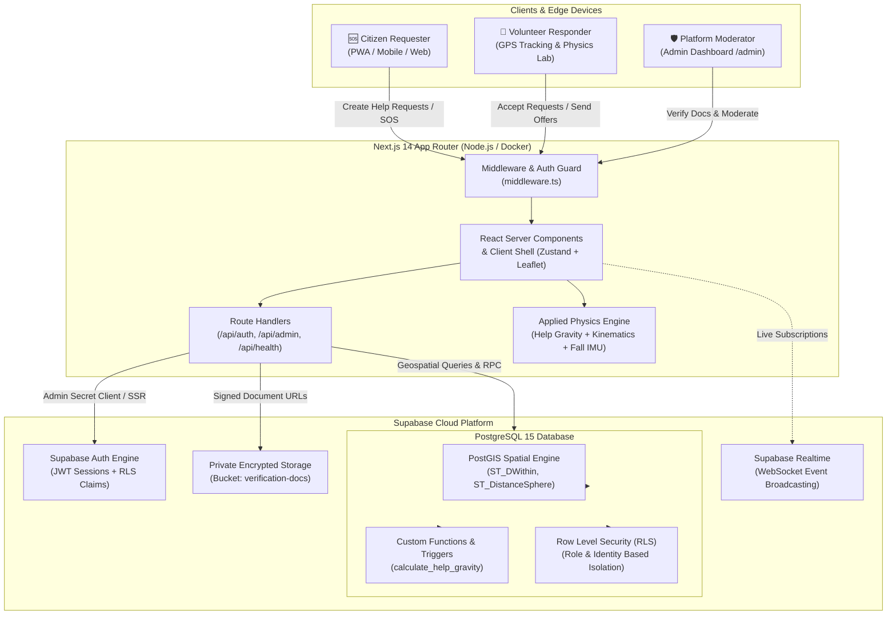

<p align="center">
  
</p>

<p align="center">
  <strong>Hyperlocal Mutual Aid & Urgent Community Crisis Response Engine</strong><br />
  <em>Powered by Classical Newtonian Help Gravity & Geospatial Kinematics</em>
</p>

<p align="center">
  <a href="https://kindlink-gd8e.onrender.com"></a>
  <a href="https://nextjs.org"></a>
  <a href="https://www.typescriptlang.org"></a>
  <a href="https://supabase.com"></a>
  <a href="https://postgis.net"></a>
  <a href="https://tailwindcss.com"></a>
  <a href="#-physics-engine-breakdown"></a>
  <a href="https://docker.com"></a>
  <a href="LICENSE"></a>
</p>

---

## 📌 Table of Contents

- [🌟 Project Overview](#-project-overview)
- [⚡ Physics Engine Breakdown](#-physics-engine-breakdown)
  - [1. Help Gravity Score (Newtonian Proximity Model)](#1-help-gravity-score-newtonian-proximity-model)
  - [2. Kinematics & Haversine Geodesic Distance Engine](#2-kinematics--haversine-geodesic-distance-engine)
  - [3. Inertial Sensor Calibration & Dynamic Fall Detector](#3-inertial-sensor-calibration--dynamic-fall-detector)
- [🔑 Showcase Demo Accounts & Credentials](#-showcase-demo-accounts--credentials)
- [🛠️ How to Run the Showcase SQL](#️-how-to-run-the-showcase-sql)
- [🏗️ Architecture & System Flow](#️-architecture--system-flow)
- [🌐 Multilingual System (7 Regional Languages)](#-multilingual-system-7-regional-languages)
- [🚀 Quickstart Guide](#-quickstart-guide)
  - [Local Development](#local-development)
  - [Cloud Deployment on Render (Docker)](#cloud-deployment-on-render-docker)
- [📁 Project Structure](#-project-structure)
- [📡 API Routes Reference](#-api-routes-reference)
- [🎓 Capstone Details & Academic Attribution](#-capstone-details--academic-attribution)
- [📄 License](#-license)

---

## 🌟 Project Overview

**KindLink** is an open-source, hyperlocal peer-to-peer mutual aid and emergency coordination platform designed to bridge the critical first-response gap in local neighborhoods.

Conceived and engineered for the industrial and mining belt spanning **Asansol, Burnpur, Durgapur, Dhanbad**, and surrounding regions (West Bengal & Jharkhand border), KindLink transforms abstract principles of classical mechanics into an equitable, real-time crisis dispatch mechanism.

### Key Community Missions:
- 🩸 **Emergency Blood Donation & Platelets**: Rapid-response volunteer mobilization for critical transfusions.
- 🩺 **Medical Equipment & Wheelchairs**: Community sharing of oxygen concentrators, nebulizers, walkers, and wheelchairs.
- 👵 **Elderly Care & Life-Saving Medicine Delivery**: Proximity-matched assistance for senior citizens needing daily essentials and prescriptions.
- 📚 **Textbooks & Educational Resources**: Peer exchange of curriculum study materials (WBBSE, CBSE, ICSE, Engineering).
- 🚑 **Emergency Patient Transport**: Rapid community vehicular assistance when conventional ambulance services face delays.

### Core Distinctions:
- **Instant Access with Zero Bureaucracy**: Eliminates friction with streamlined onboarding, local fallback resilience, and non-blocking authentication.
- **Physical Gravitational Prioritization**: Replaces arbitrary FIFO queues with a physics-based priority score that dynamically intensifies with waiting time and concentrates assistance near those closest to the incident.
- **Interactive GPS Radar**: Full-screen, responsive OpenStreetMap & Leaflet geospatial radar with live distance indicators and velocity-based ETA calculations.
- **Emergency Fall Detection & SOS Beacon**: Leverages HTML5 `DeviceMotion` inertial measurement units (IMU) to detect kinetic deceleration spikes and dispatch automated emergency distress signals.

---

## ⚡ Physics Engine Breakdown

KindLink was engineered as an applied physics capstone project, directly integrating three core physical formulations:

### 1. Help Gravity Score (Newtonian Proximity Model)

In Sir Isaac Newton's Universal Law of Gravitation, the gravitational attraction $F$ between two bodies is directly proportional to the product of their masses and inversely proportional to the square of the separation distance:

```math
F = G \frac{m_1 \cdot m_2}{r^2}
```

```text
       G · m₁ · m₂
  F = ─────────────
           r²
```

KindLink models an urgent community need as an epicenter of gravitational attraction, pulling verified local volunteers toward the point of distress. The **Help Gravity Score** is formulated as:

```math
\text{Help Gravity Score} = \frac{\text{TypeWeight} \times (1 + \lambda \times \text{waitingMinutes})}{(1 + \text{distanceKm})^2}
```

```text
                         TypeWeight × (1 + λ × waitingMinutes)
  Help Gravity Score  =  ─────────────────────────────────────
                                   (1 + distanceKm)²
```

#### Formula Breakdown & Variable Definitions:

| Parameter | Symbol / Variable | Default Value / Unit | Physical Interpretation |
| :--- | :--- | :--- | :--- |
| **Category Type Weight** | `TypeWeight` (`W_type`) | `2` to `10` (Scalar) | Inherent physical urgency scalar (analogous to gravitational mass $m_1$) based on life-criticality. |
| **Elapsed Waiting Time** | `waitingMinutes` (`Δt`) | Minutes ($\ge 0$) | Time elapsed since emergency broadcast initiation (`now() - t_created`). |
| **Urgency Accretion Rate** | `λ` (`lambda`) | `0.05 min⁻¹` (+5%/min) | Linear accretion parameter compounding urgency for unfulfilled requests over time. |
| **Geodesic Distance** | `distanceKm` (`d_km`) | Kilometers ($\ge 0$) | Great-circle Haversine distance between volunteer GPS and incident site. |
| **Inverse-Square Buffer** | `(1 + distanceKm)²` | Damped $r^2$ ($d \ge 0$) | Newton's Inverse-Square Law with a `+1.0 km` soft buffer preventing infinite force singularities as $d \to 0$. |

#### Category Urgency Weights (`W_type`):
- 🩸 **Blood Donation**: `10 / 10` (Maximum criticality; perishable life window)
- 🚑 **Emergency Transport**: `9 / 10` (Immediate transit requirement)
- 👵 **Elderly Care**: `6 / 10` (Time-sensitive vulnerability)
- 🩺 **Medical Equipment**: `5 / 10` (Essential mobility & respiratory relief)
- 📚 **Books & Study Materials**: `2 / 10` (Community educational assistance)

#### Exact SQL & TypeScript Implementations:

In Supabase PostgreSQL (`supabase/sql/05_functions.sql`):
```sql
ROUND(
  (public.category_weight(c.category) * (1.0 + 0.05 * c.waiting_minutes) 
   / power(1.0 + c.distance_km, 2)
  )::numeric, 2
)::double precision AS help_gravity_score
```

In TypeScript (`lib/data/physics.ts`):
```typescript
export function calculateHelpGravity(
  category: HelpCategory,
  waitingMinutes: number,
  distanceKm: number
): number {
  const typeWeight = CATEGORY_WEIGHTS[category] || 5;
  const timeFactor = 1 + 0.05 * Math.max(0, waitingMinutes);
  const distanceFactor = Math.pow(1 + Math.max(0, distanceKm), 2);
  const rawScore = (typeWeight * timeFactor) / distanceFactor;
  return Math.round(rawScore * 100) / 100;
}
```

---

### 2. Kinematics & Haversine Geodesic Distance Engine

To compute spatial separation across the curved surface of the Earth, KindLink employs the spherical Haversine trigonometric formulation with mean Earth radius $R = 6,371\text{ km}$:

```math
a = \sin^2\left(\frac{\Delta\phi}{2}\right) + \cos(\phi_1)\cos(\phi_2)\sin^2\left(\frac{\Delta\lambda}{2}\right)
```

```math
c = 2 \cdot \operatorname{atan2}\left(\sqrt{a}, \sqrt{1 - a}\right)
```

```math
d = R \cdot c
```

```text
  a = sin²(Δφ / 2) + cos(φ₁) · cos(φ₂) · sin²(Δλ / 2)
  c = 2 · atan2(√a, √(1 - a))
  d = R · c   (where R = 6,371 km)
```

where $\phi_1, \phi_2$ represent latitudes in radians, and $\Delta\lambda$ represents longitude difference in radians.

#### Dynamic Arrival Time (Kinematics: $v = d / t \implies t = d / v$):
KindLink calculates responder Estimated Time of Arrival (ETA) with three travel modalities:
- 🚶 **Walking**: $5\text{ km/h}$
- 🚲 **Bicycle**: $15\text{ km/h}$
- 🚗 **Vehicle / Auto / Ambulance**: $30\text{ km/h}$ (calibrated for congested municipal road corridors)

```math
\text{ETA (minutes)} = \max\left(1, \left\lceil \frac{d_{\text{km}}}{v_{\text{mode}}} \times 60 \right\rceil\right)
```

```text
                     ⌈  d_km         ⌉
  ETA (minutes) = max│1, ───── × 60  │
                     ⌊   v_mode      ⌋
```

---

### 3. Inertial Sensor Calibration & Dynamic Fall Detector

To protect isolated seniors and lone volunteers, KindLink implements client-side motion telemetry using the HTML5 `DeviceMotion` API:

1. **Stationary Bias Calibration**:
   A 3-second stationary baseline phase records Earth's local gravitational vector ($\vec{g} \approx 9.81\text{ m/s}^2$) and calibrates sensor bias $(\Delta x, \Delta y, \Delta z)$ across the three spatial axes.

2. **Discrete Low-Pass Signal Filtering**:
   High-frequency motion jitter is smoothed using a discrete first-order low-pass filter ($\alpha = 0.3$):
   ```math
   \vec{a}_{\text{filtered}}[t] = \alpha \cdot \vec{a}_{\text{raw}}[t] + (1 - \alpha) \cdot \vec{a}_{\text{filtered}}[t-1]
   ```
   ```text
   a_filtered[t] = α · a_raw[t] + (1 - α) · a_filtered[t-1]   (where α = 0.3)
   ```

3. **Net Acceleration Magnitude & Kinetic Spike Detection**:
   ```math
   \|\vec{a}_{\text{net}}\| = \sqrt{a_x^2 + a_y^2 + a_z^2}
   ```
   ```text
   |a_net| = √(ax² + ay² + az²)
   ```
   When sudden deceleration exceeds the threshold ($|\vec{a}_{\text{net}}| > 22.0\text{ m/s}^2 \approx 2.24g$) followed by prolonged immobility, an automated 10-second safety countdown is triggered, dispatching an SOS beacon with live GPS coordinates to nearby verified volunteers.

---

## 🔑 Showcase Demo Accounts & Credentials

For academic grading, portfolio evaluations, and live project presentations, KindLink includes pre-configured showcase accounts provisioned via cryptographic database migrations.

| Account Type | Username | Email | Password | Role & Showcase Permissions |
| :--- | :--- | :--- | :--- | :--- |
| 🤝 **Showcase Volunteer** | `kind_volunteer` | `volunteer@kindlink.demo` | `KindLink#Volunteer2026` | **Verified Volunteer**<br />• Browses urgent requests on the live radar<br />• Submits help offers & calculates transit ETA<br />• Accesses Physics Lab and real-time simulator |
| 🆘 **Showcase Requester** | `need_aid` | `requester@kindlink.demo` | `KindLink#Requester2026` | **Verified Citizen**<br />• Broadcasts urgent blood/equipment requests<br />• Real-time incoming responder tracking<br />• Resolves tasks with feedback ratings |
| 🛡️ **Platform Administrator** | `admin_kindlink` | `admin@kindlink.demo` | `KindLink#Admin2026` | **Super Administrator**<br />• Full access to `/admin` Moderation Portal<br />• Reviews & verifies government identity docs<br />• Resolves flagged community reports & incidents |

> [!NOTE]
> All showcase passwords are pre-hashed using `bcrypt` and match the credentials configured in migration `13_create_showcase_accounts.sql`.

---

## 🛠️ How to Run the Showcase SQL

Follow these steps in your Supabase project to execute the database migrations and provision verified showcase accounts:

### Method A: Single Atomic Master Run (Recommended)
Execute [`supabase/sql/all_in_one_v2.sql`](supabase/sql/all_in_one_v2.sql) — a complete, fully idempotent migration wrapped in an atomic `BEGIN ... COMMIT` transaction:
1. Log in to your [Supabase Dashboard](https://supabase.com/dashboard) and select your KindLink project.
2. In the left navigation sidebar, click on **SQL Editor** (icon: `>_`) -> **+ New query**.
3. Open [`supabase/sql/all_in_one_v2.sql`](supabase/sql/all_in_one_v2.sql), copy its entire content, paste it into the editor, and click **Run**.
4. **What this accomplishes in one single execution:**
   - ✅ Activates `uuid-ossp`, `pgcrypto`, and `postgis` with custom tolerance cast overloads.
   - ✅ Creates and verifies all tables: `profiles`, `requests`, `offers`, `notifications`, `ratings`, `reports`, `sos_events`, `active_transit_locations`, `emergency_contacts`, `user_badges`, `auth_otps`, `push_subscriptions`.
   - ✅ Applies PostGIS GiST spatial indexes and performance B-Tree indexes.
   - ✅ Deploys the Help Gravity engine, notification triggers, and RLS security policies.
   - ✅ Provisions the 3 official showcase demo accounts (`kind_volunteer`, `need_aid`, `admin_kindlink`).
   - ✅ Deploys the `live_stats(p_lat, p_lng, p_radius_km)` RPC engine for real-time community pulse indicators.
   - ✅ Deploys `get_email_by_username()` RPC for universal identifier authentication.
   - ✅ Purges leftover test/dummy data while preserving genuine users and showcase accounts.

---

### Method B: Incremental Upgrade Migrations (For Existing Databases)
If you already applied the base schema (`01` through `13`), execute these upgrade files in sequence:
1. **`14_comprehensive_live_upgrade.sql`**: Deploys SOS live tracking, volunteer heartbeat, `live_stats` function, and real-time publications.
2. **`15_cleanup_test_data.sql`**: Safely purges legacy placeholder requests and test accounts while preserving showcase accounts.
3. **`16_login_signup_helpers.sql`**: Provisions `get_email_by_username()` RPC and username unique constraint indexing.

---

## 🏗️ Architecture & System Flow

KindLink is built on a resilient, modular cloud-native architecture combining the Next.js 14 App Router, PostgreSQL with PostGIS, and Supabase security primitives:



### Architectural Highlights:
- **Zero-Flicker Multi-tier Client**: Hybrid architecture utilizing React Server Components for initial payload streaming and hydration-safe Client Components for Leaflet GIS maps.
- **Row Level Security (RLS)**: Fine-grained policies ensure that personal contact details and government identity cards are only accessible to verified participants and platform administrators.
- **Dual Data Adapter Strategy**: Includes both a live `SupabaseAdapter` for cloud production and an in-memory `MockAdapter` fallback for offline testing or development without credentials.

---

## 🌐 Native Multilingual Engine (34 Languages & Dialects)

KindLink features a high-performance native JSON dictionary internationalization engine (`lib/i18n/dictionaries/`) with zero external API dependencies for core UI elements, complete layout mirroring for Right-to-Left (**RTL**) scripts, and locale persistence in HTTP cookies.

### Language Coverage Overview:
- 🇮🇳 **17 Scheduled & Regional Indian Languages**: English, हिन्दी (Hindi), বাংলা (Bengali), भोजपुरी (Bhojpuri), मैथिली (Maithili), नेपाली (Nepali), اردو (Urdu - **RTL**), ᱥᱟᱱᱛᱟᱲᱤ (Santali Ol Chiki), ଓଡ଼ିଆ (Odia), অসমীয়া (Assamese), मराठी (Marathi), ગુજરાતી (Gujarati), ਪੰਜਾਬੀ (Punjabi), தமிழ் (Tamil), తెలుగు (Telugu), ಕನ್ನಡ (Kannada), മലയാളം (Malayalam).
- ⛏️ **5 Jharkhand & Tribal Dialects (Beta)**: नागपुरी (Nagpuri), खोरठा (Khortha), कुड़ुख़ (Kurukh), मुंडारी (Mundari), हो (Ho).
- 🌍 **12 International Languages**: French, Spanish, German, Portuguese, Italian, Russian, Chinese Simplified (简体中文), Japanese (日本語), Korean (한국어), Arabic (العربية - **RTL**), Indonesian, Turkish.

### Key Internationalization Features:
- **Zero Translation Flicker**: Native pre-compiled JSON dictionaries load instantly on user selection.
- **Bi-Directional Layouts**: Automatic `dir="rtl"` layout flipping for Urdu (`ur`) and Arabic (`ar`).
- **Dynamic Content Safeguards**: Scoped UI containers with `translate="no"` attributes to prevent external browser translation widgets from corrupting sensitive buttons, emergency contact numbers, or blood donation groups.

---

## 🚀 Quickstart Guide

### Local Development

#### Prerequisites:
- **Node.js**: `v18.17+` or `v20+`
- **Git**
- **npm** or **pnpm**

```bash
# 1. Clone the repository
git clone https://github.com/krishkumarcodes/KindLink.git
cd KindLink

# 2. Install dependencies
npm install

# 3. Configure environment variables
cp .env.example .env.local
# Edit .env.local with your Supabase credentials

# 4. Start the development server
npm run dev
```

Visit [`http://localhost:3000`](http://localhost:3000) in your web browser.

---

### Cloud Deployment on Render (Docker)

KindLink is fully configured for continuous deployment on **Render** using a lightweight, multi-stage Docker container.

#### 1. Blueprint Deployment via `render.yaml`
1. Fork or push this repository to your GitHub account.
2. Log in to [Render](https://render.com).
3. Click **New +** -> **Blueprint**.
4. Select your `KindLink` repository. Render will automatically parse [`render.yaml`](render.yaml).
5. Add the environment variables from [`.env.render`](.env.render) into the Render dashboard environment configuration.
6. Click **Apply**.

#### 2. Manual Docker Web Service Deployment
1. Click **New +** -> **Web Service**.
2. Select your repository.
3. Select **Docker** as the Environment.
4. Set the Health Check Path to:
   ```text
   /api/health
   ```
5. In **Environment Variables**, import the values from `.env.render`:
   ```ini
   PORT=3000
   NODE_ENV=production
   DATA_SOURCE=supabase
   NEXT_PUBLIC_DATA_SOURCE=supabase
   NEXT_PUBLIC_SUPABASE_URL=https://<your-project>.supabase.co
   NEXT_PUBLIC_SUPABASE_ANON_KEY=<your-anon-key>
   NEXT_PUBLIC_SUPABASE_PUBLISHABLE_KEY=<your-anon-key>
   SUPABASE_SERVICE_ROLE_KEY=<your-service-role-key>
   SUPABASE_SECRET_KEY=<your-service-role-key>
   ```
6. Click **Deploy Web Service**.

#### 3. Test Container Locally via Docker:
```bash
# Build production Docker image
docker build -t kindlink .

# Run Docker container
docker run -p 3000:3000 -e PORT=3000 kindlink

# Verify health endpoint
curl http://localhost:3000/api/health
```

---

## 📁 Project Structure

```text
KindLink/
├── app/                              # Next.js 14 App Router Directory
│   ├── admin/                        # Super Admin Moderation Portal
│   ├── api/                          # Next.js Server Route Handlers
│   │   ├── admin/                    # Protected Admin APIs (reports, verifications)
│   │   ├── auth/                     # Authentication Endpoints (login, signup, OTP, resolve)
│   │   ├── sos/[token]/              # Realtime SOS Emergency Polling Endpoint
│   │   ├── stats/live/               # Realtime Live Community Pulse RPC Endpoint
│   │   └── health/route.ts           # Docker & Render Health Check Endpoint
│   ├── app/page.tsx                  # Authenticated Interactive Radar & Core App
│   ├── login/page.tsx                # Universal Sign-in Page (Email & Username)
│   ├── signup/page.tsx               # Citizen Registration Page
│   ├── sos/[token]/page.tsx          # Public Unauthenticated SOS Live Tracking Page
│   ├── layout.tsx                    # Root HTML, Fonts & Providers Layout
│   ├── page.tsx                      # Statically Rendered Public Landing Page
│   └── globals.css                   # Tailwind Base Directives & Animations
├── components/                       # Modular React UI Components
│   ├── auth/                         # Inline & Dedicated Auth Modals & Forms
│   ├── home/                         # Realtime Stats Pulse & Feed Cards
│   ├── map/                          # Leaflet GIS Radar & Dynamic Markers
│   ├── physics/                      # Interactive Physics Lab & Gravity Simulator
│   ├── profile/                      # User Profile, Badges, Impact & Verification
│   ├── requests/                     # Urgent Requests List & Filter Engine
│   ├── shell/                        # Header (SOS Pill, Location Chip), Bottom Nav
│   └── wizard/                       # Multi-step Urgent Request Creation Modal
├── lib/                              # Core Utility & Service Layer
│   ├── data/                         # Data Adapters & Physics Mechanics
│   │   ├── adapter.ts                # Abstract Data Adapter Interface
│   │   ├── mock-adapter.ts           # In-Memory Offline Storage Engine
│   │   ├── physics.ts                # Help Gravity & Haversine Implementations
│   │   ├── supabase-adapter.ts       # Live Supabase Production Client Adapter
│   │   └── types.ts                  # Domain TypeScript Types & Models
│   ├── i18n/                         # Native 34-Language JSON Dictionary Engine
│   ├── store/                        # Zustand Global State Management (v3)
│   └── supabase/                     # Supabase Client, Server, Admin & Realtime
├── supabase/                         # Supabase Database Migrations
│   ├── sql/                          # Ordered Database Migrations (01 to 16)
│   │   ├── 01_extensions.sql         # PostGIS Extension & Cast Overloads
│   │   ├── 02_types.sql              # Enums (help_category, request_status)
│   │   ├── 03_tables.sql             # Relational Schema Definition
│   │   ├── 04_indexes.sql            # Spatial GiST & B-tree Indexes
│   │   ├── 05_functions.sql          # Stored Procedures & Physics Scoring
│   │   ├── 06_triggers.sql           # PostGIS-Safe Dispatch Triggers
│   │   ├── 07_rls_policies.sql       # Row Level Security Policies
│   │   ├── 12_cleanup_demo_users.sql # Safe Demo User Purge Script
│   │   ├── 13_create_showcase_accounts.sql # Showcase Credential Provisioning
│   │   ├── 14_comprehensive_live_upgrade.sql # Realtime Platform Upgrade
│   │   ├── 15_cleanup_test_data.sql  # Safe Purge of Legacy Test Data
│   │   ├── 16_login_signup_helpers.sql # Username Authentication Helper RPC
│   │   ├── all_in_one.sql            # Consolidated Single-Run Migration
│   │   └── all_in_one_v2.sql         # Master Atomic Migration (BEGIN...COMMIT)
├── Dockerfile                        # Multi-Stage Node 22 Alpine Build
├── package.json                      # Dependencies & Scripts
├── render.yaml                       # Render Infrastructure as Code Blueprint
└── tailwind.config.ts                # Custom Design Tokens & Colors
```

---

## 📡 API Routes Reference

| Method | Endpoint | Auth Required | Description |
| :--- | :--- | :---: | :--- |
| `GET` | `/api/health` | ❌ No | Health check returning status `ok`, timestamp, and environment. Used by Docker & Render. |
| `GET` | `/api/stats/live` | ❌ No | Returns live community stats (active helpers, median response time, completed acts, trust %). |
| `POST` | `/api/auth/resolve-identifier` | ❌ No | Resolves an entered username or email to valid authentication credentials. |
| `GET` | `/api/sos/[token]` | ❌ No | Streams live emergency location, elapsed time, and status for a given SOS token link. |
| `POST` | `/api/auth/login` | ❌ No | Authenticates via email or username with rate limiting and returns a signed Supabase session. |
| `POST` | `/api/auth/signup` | ❌ No | Registers a new account, validates username availability, and provisions public profile. |
| `POST` | `/api/auth/logout` | ❌ No | Clears active authentication cookies and terminates user session. |
| `GET` | `/api/auth/check-username` | ❌ No | Debounced verification checking whether a candidate username is unique and valid. |
| `POST` | `/api/auth/otp/send` | ❌ No | Generates and transmits a secure 6-digit numeric verification OTP with 10-minute expiry. |
| `POST` | `/api/auth/otp/verify` | ❌ No | Validates 6-digit verification OTP against active rate-limited challenges. |
| `POST` | `/api/auth/change-password` | ✅ Yes | Validates current password and updates to a new password with session revocation options. |
| `GET` | `/api/admin/reports` | 🛡️ Admin | Retrieves reported incidents, flagging reasons, and community moderation queue. |
| `POST` | `/api/admin/reports` | 🛡️ Admin | Actions incident reports (mark resolved, dismiss, or apply moderator actions). |
| `GET` | `/api/admin/verifications` | 🛡️ Admin | Fetches pending government identity verification submissions and document references. |
| `POST` | `/api/admin/verifications` | 🛡️ Admin | Approves or rejects volunteer identity verification requests, toggling badge status. |

---

## 🎓 Capstone Details & Academic Attribution

KindLink was engineered as a B.Tech Computer Science & Engineering (CSE) Physics Capstone Project at:

<p align="center">
  <strong>Asansol Engineering College (AEC)</strong><br />
  <em>Affiliated to Maulana Abul Kalam Azad University of Technology (MAKAUT), West Bengal, India</em>
</p>

- **Lead Engineer & Author**: [Krish Kumar](https://github.com/krishkumarcodes) (`krishkumarcodes@gmail.com`)
- **Academic Focus**: Applied Classical Mechanics in Societal Computing & Crisis Dispatch
- **Core Physics Translation**:
  1. Translation of Newton's Universal Gravitation (`F = G · (m₁ · m₂) / r²`) into urgency scoring.
  2. Spherical Trigonometry & Haversine Geodesic formulation (`d = 2R · arcsin(√a)`).
  3. Dynamic Kinematics (`v = d / t` $\implies$ `ETA = d / v`).
  4. Inertial Acceleration Vector Analysis (`|a_net| = √(ax² + ay² + az²)`) and Low-Pass Noise Suppression.

---

## 📄 License

This project is open-source software licensed under the **[MIT License](LICENSE)**:

```text
MIT License

Copyright (c) 2026 Krish Kumar (krishkumarcodes@gmail.com) and KindLink Contributors

Permission is hereby granted, free of charge, to any person obtaining a copy
of this software and associated documentation files (the "Software"), to deal
in the Software without restriction, including without limitation the rights
to use, copy, modify, merge, publish, distribute, sublicense, and/or sell
copies of the Software, and to permit persons to whom the Software is
furnished to do so, subject to the following conditions:
...
```

KindLink is fully open-source, non-profit, and dedicated to empowering communities with equitable, physics-driven mutual aid. Contributions, forks, and academic extensions are warmly welcomed.
