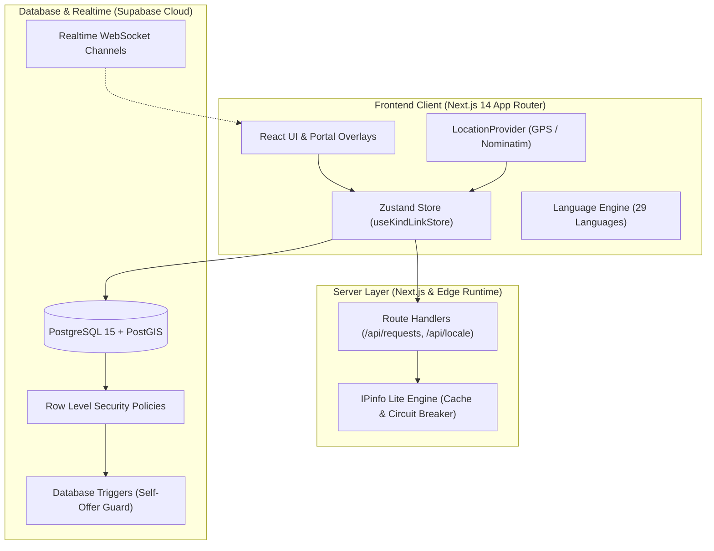

<p align="center">
  
</p>

<h1 align="center">KindLink</h1>

<p align="center">
  <strong>Hyperlocal Mutual Aid & Urgent Community Crisis Response Platform</strong><br />
  <em>Powered by Three-Key Urgency Dispatch, OpenStreetMap Road Routing & Verified Community Trust</em>
</p>

<p align="center">
  <a href="https://github.com/krishkumarcodes/KindLink/releases/tag/v4.8.1"></a>
  <a href="https://kindlink-gd8e.onrender.com"></a>
  <a href="https://nextjs.org"></a>
  <a href="https://www.typescriptlang.org"></a>
  <a href="https://supabase.com"></a>
  <a href="https://postgis.net"></a>
  <a href="https://tailwindcss.com"></a>
  <a href="https://docker.com"></a>
  <a href="LICENSE"></a>
</p>

---

## 👨‍💻 Creator & Lead Architect

KindLink was conceptualized, designed, and engineered from the ground up by:

<p align="center">
  <a href="https://github.com/krishkumarcodes">
    
  </a><br />
  <strong><a href="https://github.com/krishkumarcodes">Krish Kumar</a></strong><br />
  <em>Lead Systems Architect & Full-Stack Developer</em><br />
  <code>krishkumarcodes@gmail.com</code> • <a href="https://github.com/krishkumarcodes">@krishkumarcodes</a>
</p>

### 📊 Live GitHub Activity & Contribution Metrics

<p align="center">
  <a href="https://github.com/krishkumarcodes">
    
  </a>
</p>

<p align="center">
  <a href="https://github.com/krishkumarcodes">
    
  </a>
  <a href="https://github.com/krishkumarcodes">
    
  </a>
</p>

### 🌟 Key Contributions by Krish Kumar:
- 🚀 **End-to-End System Architecture**: Engineered KindLink through iterations v1.0 through v4.7.0, integrating Next.js 14 App Router, TypeScript, and Supabase.
- ⌨️ **Universal Command Palette & Quick Actions**: Built accessible `⌘K` / `Ctrl+K` power-user navigator across all 15 aid categories, emergency workflows, core views, and live request lookup.
- 🗺️ **OpenFreeMap Vector Engine & GIS Radar**: Integrated key-free OpenFreeMap vector tiles with client-side dark theme restyling and automated 4-second failover cascade.
- ⚡ **Three-Key Community Urgency Engine**: Formulated and implemented the deterministic three-key dispatch model (Urgency Level > Proximity > Waiting Time).
- 📶 **Offline SOS & SMS Fallback Engine**: Engineered cellular carrier SMS dispatch with standardized coordinates, Google Maps deep-links, live tracking URLs, and dual iOS/Android URL schemes.
- 🔐 **4-Digit Handover Confirmation PIN**: Designed secure physical exchange verification for medical equipment loans and educational handovers with requester PIN cards and auto-focus helper modals.
- 🏛️ **Verified Organization / NGO Endorsement Badges**: Built institutional profile tiers, verification shields, and 1-tap request endorsements for community welfare societies and blood banks.
- 📱 **1-Tap Social Story Card Generator**: Created high-resolution HTML5 Canvas rendering for 9:16 vertical Stories and 1:1 Square cards with instant WhatsApp sharing, native mobile share sheets, and auto-generated QR codes.
- 🗺️ **High-Performance Map & Road Routing**: Engineered Leaflet GIS radar, multi-tier tile fallbacks (MapTiler -> Carto -> OSM), and dynamic travel modes (Bike, Walking, Car).
- 🛡️ **Four-Tier Own-Request Rule**: Enforced strict self-offer prevention across UI cards, state adapters, Next.js server endpoints, and PostgreSQL triggers.
- 🌐 **Intelligent Language Detection Engine**: Integrated IPinfo Lite with zero-delay fallback, 29 verified languages, in-memory caching, and crawler immunity.
- 🏅 **Visual Identity & Design System**: Crafted true circular badge medals, WCAG AA compliant category palettes, and portal-based mobile overlay architecture.

---

## 📌 Table of Contents

- [🌟 Project Overview](#-project-overview)
- [✨ What's New in v4.5.0](#-whats-new-in-v450)
- [📶 Offline SOS & SMS Fallback Engine](#-offline-sos--sms-fallback-engine)
- [🔐 4-Digit Handover Confirmation PIN](#-4-digit-handover-confirmation-pin)
- [🏛️ Verified Organization / NGO Badges](#️-verified-organization--ngo-badges)
- [📱 1-Tap Social Story Card Generator](#-1-tap-social-story-card-generator)
- [⚡ Three-Key Community Urgency Ranking](#-three-key-community-urgency-ranking)
- [🛡️ Four-Layer Own-Request Protection](#️-four-layer-own-request-protection)
- [🗺️ Route Mini-Map & Live Road Routing](#️-route-mini-map--live-road-routing)
- [🎨 Category Colors & WCAG AA Contrast](#-category-colors--wcag-aa-contrast)
- [🏅 Circular Badge Medals & Profile System](#-circular-badge-medals--profile-system)
- [🌐 Multilingual System & First-Visit Detection](#-multilingual-system--first-visit-detection)
- [🏗️ System Architecture & Data Flow](#️-system-architecture--data-flow)
- [📁 Project Directory Structure](#-project-directory-structure)
- [🛠️ Supabase Database Migrations](#️-supabase-database-migrations)
- [🚀 Quickstart & Setup Guide](#-quickstart--setup-guide)
- [🧪 Automated Test Verification Suite](#-automated-test-verification-suite)
- [📡 API Routes Reference](#-api-routes-reference)
- [📄 License & Community Attribution](#-license--community-attribution)

---

## 🌟 Project Overview

**KindLink** is an open-source, hyperlocal peer-to-peer mutual aid and emergency crisis coordination platform designed to bridge the vital first-response gap in local neighborhoods.

Conceived for industrial and urban communities across **Asansol, Burnpur, Durgapur, Dhanbad**, and surrounding regions, KindLink connects community goodwill with people who need urgent help.

```
       [ Citizen in Urgent Need ]
                  │
                  ▼
     ┌────────────────────────┐
     │  Post Urgent Request   │ (Blood, Medical Gear, Elderly, Books, Transit)
     └────────────────────────┘
                  │
                  ▼
     ┌────────────────────────┐
     │ Three-Key Urgency Sort │ (Urgency > Proximity > Waiting Time)
     └────────────────────────┘
                  │
        ┌─────────┴─────────┐
        ▼                   ▼
┌───────────────┐   ┌────────────────┐
│ Live Map Pin  │   │ Proximity Feed │
└───────────────┘   └────────────────┘
        │                   │
        └─────────┬─────────┘
                  ▼
     ┌────────────────────────┐
     │ Verified Helper Offers │ (Auto-growing notes, travel ETA, location)
     │ NGO Endorsements (★)   │ (Institutional credibility & trust shields)
     └────────────────────────┘
                  │
                  ▼
     ┌────────────────────────┐
     │     Mutual Match       │ ──► Direct Phone/WhatsApp Reveal
     └────────────────────────┘
                  │
                  ▼
     ┌────────────────────────┐
     │  Handover Security PIN │ ──► 4-Digit physical exchange verification
     └────────────────────────┘
```

### Community Aid Categories:
- 🩸 **Emergency Blood Donation & Platelets**: Rapid-response volunteer mobilization for critical transfusions.
- 🩺 **Medical Equipment & Wheelchairs**: Neighborhood sharing of oxygen concentrators, nebulizers, walkers, and wheelchairs.
- 👵 **Elderly Care & Life-Saving Medicine Delivery**: Proximity-matched assistance for senior citizens needing daily essentials and prescriptions.
- 📚 **Textbooks & Educational Resources**: Peer exchange of curriculum study materials and school supplies.
- 🚑 **Emergency Patient Transport**: Rapid community vehicular assistance when conventional ambulance services face delays.

---

## ✨ What's New in v4.5.0

The **v4.5.0** release delivers four landmark community resilience and emergency security capabilities:

| Feature Area | Superpower in v4.5.0 |
| :--- | :--- |
| 📶 **Offline SOS & SMS Fallback** *(Feature B)* | Automatic detection of low-signal or zero-connectivity states with a 2.5s network dispatch race; standardized SMS body with 5-decimal GPS coordinates, Google Maps deep-link, and tracking URL; cross-platform Android (`?body=`) & iOS (`&body=`) SMS URI builder with 1-tap "Send to All Emergency Contacts". |
| 🔐 **4-Digit Handover PIN** *(Feature E)* | Anti-fraud handover confirmation for medical gear loans and study books; requester sees prominent 4-digit PIN card; helper inputs PIN via accessible `HandoverPinModal` with auto-focus and paste support to verify physical delivery and complete request. |
| 🏛️ **Verified Organization / NGO Endorsements** *(Feature F)* | Institutional profile credentials (name, type, registration number, verification shield); prominent `★ NGO Endorsed` badge on cards and details sheets; 1-tap endorsement actions for verified NGOs, hospitals, and community welfare societies. |
| 📱 **1-Tap Social Story Card Generator** *(Feature H)* | High-resolution HTML5 Canvas engine exporting 9:16 vertical Instagram Stories / WhatsApp Status cards and 1:1 Square feed cards; category accent themes, urgency badges, live QR code linking directly to the request, and native mobile share sheet integration. |
| 📋 **Request Details Overhaul** | Redesigned portal bottom sheet with sticky top/bottom bars, 6-step Realtime tracker, 3 equal info tiles (Waiting, Needed by, Distance), category detail chips, and requested-by privacy card. |
| 🗺️ **Route Mini-Map** | Fixed 0x0 container size using `ResizeObserver` + delayed `invalidateSize()`; multi-tier fallback (MapTiler -> Carto Voyager/Dark -> OSM); Bike/Walk/Car speed modes. |
| 🛡️ **Own-Request Prevention** | 4-layer enforcement preventing authors from helping their own requests across UI, Client Stores, Server API (`403 Forbidden`), and PostgreSQL trigger `trg_prevent_self_offer`. |
| 🏅 **Circular Badge Medals** | True circular medals (`border-radius: 50%`, `overflow: hidden`), transparent corners, zero yellow halo, and distinct artwork for all 18 badges. |
| 🌐 **First-Visit Language** | IPinfo Lite country-to-language detector with in-memory caching, bot immunity, and zero-delay English fallback. |

---

## 📶 Offline SOS & SMS Fallback Engine

When accidents, medical crises, or natural disasters occur, cellular data towers are often congested or unavailable. KindLink v4.5.0 introduces **Carrier-Level Offline SOS**:

```
[Emergency SOS Activated]
         │
         ├── Online (>2.5s signal)? ────► Cloud Dispatch to Supabase Realtime
         │
         └── Offline or Timeout (>2.5s)? ──► Pulsing Offline SMS Mode
                                                  │
                ┌─────────────────────────────────┴─────────────────────────────────┐
                ▼                                                                   ▼
    [Send to All Contacts]                                              [Single Contact 1-Tap]
   sms:+9198...,+9198...?body=...                                      sms:+9198...?body=...
```

- **Zero Data Required**: Dispatches emergency coordinates via standard cellular SMS over GSM/CDMA networks.
- **Cross-Platform Compatibility**: Automatically detects iOS vs Android to format proper URI query parameters (`sms:+91...?body=` vs `sms:+91...&body=`).
- **Standardized Emergency Payload**:
  ```text
  EMERGENCY SOS: Sneha Roy needs urgent help!
  Location: Asansol Court Area (Lat: 23.68886, Lng: 86.96606)
  Google Maps: https://www.google.com/maps/search/?api=1&query=23.68886,86.96606
  Live Tracking: https://kindlink-gd8e.onrender.com/sos/active
  Blood Group: B+
  Sent via KindLink Offline SOS.
  ```

---

## 🔐 4-Digit Handover Confirmation PIN

To ensure community medical equipment (wheelchairs, nebulizers, oxygen cylinders) and textbooks are safely returned and verified upon physical delivery:

1. **Requester Security View**: When a helper is accepted, the requester is shown a high-contrast 4-digit PIN card (e.g. `[ 4 ] [ 8 ] [ 2 ] [ 1 ]`).
2. **Physical Delivery Verification**: When the helper arrives, they request the PIN from the requester and enter it into the `HandoverPinModal`.
3. **Automated Status Progression**: Correct PIN entry instantly updates the database status to `completed`, stores `handover_confirmed_at`, and triggers prompt rating dialogs for both parties.

---

## 🏛️ Verified Organization / NGO Badges

Local community institutions—such as Red Cross Society Asansol, Blood Donors Forum, and Resident Welfare Associations—can now formally verify and endorse high-priority requests:

- **Organization Profiles**: Verified profile badge with organization registration number and authority type (`ngo`, `blood_bank`, `hospital`, `resident_welfare`, `student_union`).
- **`★ NGO Endorsed` Badge**: Requests endorsed by registered institutions display an unmistakable violet badge on cards and map popovers.
- **1-Tap Endorse Action**: Verified organization accounts can endorse requests in real-time to mobilize community volunteers rapidly.

---

## 📱 1-Tap Social Story Card Generator

Mobilize volunteers across social networks in seconds without manual typing or screenshots:

- **Two Formats**:
  - **Story Format (9:16 - 1080 × 1920)**: Formatted for Instagram Stories, WhatsApp Status, and Snapchat.
  - **Square Format (1:1 - 1080 × 1080)**: Formatted for WhatsApp Chats, Facebook feeds, and Twitter / X.
- **Embedded QR Code**: Automatically renders a high-contrast QR code pointing directly to the live request URL.
- **Native Web Share**: Invokes `navigator.share()` with direct file attachment support on mobile devices.


---

## ⚡ Three-Key Community Urgency Ranking

KindLink prioritizes community help requests using an honest, deterministic three-key sorting model:

```sql
ORDER BY
  CASE r.urgency
    WHEN 'critical' THEN 1
    WHEN 'high'     THEN 2
    WHEN 'medium'   THEN 3
    WHEN 'low'      THEN 4
    ELSE 5
  END ASC,
  distance_km ASC,
  r.created_at ASC;
```

1. **Primary Key: Urgency Level**
   - **Critical** (Rank 1): Emergency blood donations, life-critical patient transit, acute medical distress.
   - **High** (Rank 2): Oxygen refills, urgent prescription deliveries, specialized mobility needs.
   - **Medium** (Rank 3): General medical equipment loans, senior check-ins, household mobility support.
   - **Low** (Rank 4): Textbook exchanges, community study materials, non-urgent neighborhood lending.
2. **Secondary Key: Nearest Distance**
   - Responders living closest to the request location receive top priority. Calculated using real road distances via OpenStreetMap road routing.
3. **Tertiary Key: Longest Waiting Time**
   - Unresolved requests that have been waiting longer steadily rise to the top of their urgency tier, ensuring no critical request is buried or forgotten.

---

## 🛡️ Four-Layer Own-Request Protection

To preserve platform integrity and prevent confusion, KindLink enforces that a user **cannot offer help on their own request** across four independent layers:

```
[Layer 1: UI View]
 └─► Requester views card ──► "Offer help" button replaced by "Your Request" badge & Owner Controls

[Layer 2: State & Adapters]
 └─► Adapter checks `isRequestOwner()` ──► Returns `{ success: false, code: 'own_request' }`

[Layer 3: Next.js Server API]
 └─► POST /api/requests/[id]/offer ──► Verifies `auth.uid() !== requester_id` ──► Returns 403 Forbidden

[Layer 4: PostgreSQL Database Engine]
 └─► Trigger `trg_prevent_self_offer` ──► BEFORE INSERT/UPDATE ON public.offers ──► Raises Exception P0001
```

---

## 🗺️ Route Mini-Map & Live Road Routing

The Request Details sheet includes an interactive mini-map displaying the exact route between the helper and the requester:

- **Root Cause Resolution**: Resolved Leaflet 0x0 container size during modal slide-in by attaching a `ResizeObserver` with staged `invalidateSize()` calls at 50ms, 150ms, 300ms, and 600ms.
- **Multi-Tier Tile Fallbacks**:
  1. MapTiler Vector / Raster tiles.
  2. Carto Voyager (Light) & Carto Dark Matter (Dark) for native theme styling without CSS inversion artifacts.
  3. OpenStreetMap standard tile layer.
- **Referrer Policy**: Configured `referrerPolicy="strict-origin-when-cross-origin"` to ensure strict HTTPS tile delivery.
- **Travel Modes Control**: 3-button segmented selector (Bike: 15 km/h, Walk: 4.5 km/h, Car: 35 km/h) updating distance and ETA live, persisted in `localStorage['kindlink_travel_mode']`.

---

## 🎨 Category Colors & WCAG AA Contrast

All primary aid action buttons use dedicated category color tokens verified for **WCAG AA contrast ($\ge 4.5:1$)** against pure white text (`#FFFFFF`):

| Category | Tailwind Token | Hex Code | Contrast Ratio | Status |
| :--- | :--- | :---: | :---: | :---: |
| **Emergency Blood** | `category-blood` | `#C62828` | **6.29:1** | ✅ PASS WCAG AA |
| **Medical Equipment** | `category-medical` | `#0F766E` | **5.47:1** | ✅ PASS WCAG AA |
| **Elderly Care** | `category-elderly` | `#4F46E5` | **6.70:1** | ✅ PASS WCAG AA |
| **Books & Study** | `category-books` | `#047857` | **5.48:1** | ✅ PASS WCAG AA |
| **Emergency Transit** | `category-transit` | `#B45309` | **5.02:1** | ✅ PASS WCAG AA |

> [!NOTE]
> Urgency indicators (Critical `#E5484D`, High `#F59E0B`, Medium `#3B82F6`, Low `#10B981`) remain strictly separate for urgency badges and indicator dots only.

---

## 🏅 Circular Badge Medals & Profile System

The badge medal system has been rebuilt from scratch in [`BadgeMedalIcon.tsx`](file:///data/data/com.termux/files/home/storage/downloads/KindLink/components/profile/BadgeMedalIcon.tsx):

- **True Circular Geometry**: Strict 1:1 aspect ratio, `border-radius: 50%`, and `overflow: hidden` across all presets (`sm: 40px`, `shelf: 48px`, `md: 64px`, `detail: 80px`, `xl: 96px`).
- **Zero Artifacts**: Transparent corners with zero square dark boxes and zero yellow glow halo around silver/platinum medals.
- **Crisp Metallic Tiers**: Bronze (`#B45309`), Silver (`#94A3B8`), Gold (`#F59E0B`), and Platinum (`#38BDF8`).
- **Location Line Priority**: Live GPS area name -> saved `home_neighborhood` -> "Add your area" prompt (zero hard-coded college fallbacks).

---

## 🌐 Multilingual System & First-Visit Detection

KindLink supports **29 verified languages** (17 Indian languages + 12 International languages) with full RTL layout support for Urdu (`ur`) and Arabic (`ar`):

- **First-Visit IP Detection**: Leverages IPinfo Lite to detect the visitor's country on first visit:
  - India (`IN`) defaults to English (`en`).
  - Supported international countries default to their native language (e.g. France -> `fr`, Spain -> `es`, Germany -> `de`, Japan -> `ja`).
- **User Preference Sovereignty**: Once a user explicitly chooses a language, their choice is saved to `kindlink_lang` cookie & localStorage and **never** overwritten by IP checks.
- **Crawler & Bot Immunity**: Search engine bots (Googlebot, Bingbot, GPTBot, ClaudeBot) are served English instantly with zero API calls.
- **In-Memory Cache & Circuit Breaker**: IP lookups are cached in memory; 5 consecutive failures trip a 5-minute cooldown protecting site performance.

---

## 🏗️ System Architecture & Data Flow



---

## 📁 Project Directory Structure

```
KindLink/
├── app/                              # Next.js 14 App Router Routes
│   ├── api/                          # Backend API Route Handlers
│   │   ├── admin/                    # Verifications & Moderation Endpoints
│   │   ├── auth/                     # Authentication & OTP Handlers
│   │   ├── locale/                   # Country-to-Language Detection Endpoint
│   │   ├── requests/                 # Requests & Help Offer Handlers
│   │   │   └── [id]/offer/route.ts   # Secure Self-Offer Guard Endpoint
│   │   ├── sos/                      # Live SOS Streaming Route
│   │   ├── stats/                    # Live Community Pulse Endpoint
│   │   └── health/route.ts           # Health Check Endpoint
│   ├── layout.tsx                    # Root HTML, Fonts & Global Providers
│   ├── page.tsx                      # Main Interactive Application View
│   └── globals.css                   # Tailwind Base Styles & Theme Tokens
├── components/                       # Modular React UI Components
│   ├── home/                         # Home Hero, Active Strip & Urgent Feeds
│   ├── map/                          # Leaflet GIS Radar, Mini-Map & Tile Layer
│   ├── profile/                      # Circular Badge Medals, Header & OrganizationBadge
│   ├── requests/                     # Request Details, HandoverPinModal & EmergencyStoryCardModal
│   ├── shell/                        # Header, Navigation & Modals
│   ├── sos/                          # Emergency SOS Modal & Offline SMS Fallback
│   └── ui/                           # Shared Radix Portal Overlays & Switches
├── lib/                              # Business Logic, Adapters & Services
│   ├── data/                         # Adapters, Ownership Logic & Category Colors
│   ├── geo/                          # OSRM Road Routing & Hospital Finder
│   ├── locale/                       # IPinfo Lookup & Country-Language Rules
│   ├── sos/                          # Emergency SMS Payload & Dual OS URI Generator
│   ├── store/                        # Zustand Global State Management
│   ├── supabase/                     # Supabase Client, Server & Realtime
│   └── utils/                        # HTML5 Canvas Story Generator & QR Code Engine
├── supabase/                         # Database Schema, Migrations & Tests
│   ├── sql/                          # Migrations 01 through 18
│   │   ├── 17_own_request_rules.sql  # Self-Offer Guard & Feed Cleanups
│   │   ├── 18_handover_pin_and_org_endorsements.sql # Handover PIN & NGO Endorsements
│   │   └── all_in_one.sql            # Consolidated Single-Run Schema
│   └── tests/                        # 35 PostgreSQL Assertion Test Cases
├── scripts/                          # Automated QA & Audit Scripts
│   ├── check-clean.mjs               # Clean Architecture & Zero-Forbidden Words Audit
│   ├── check-layout.mjs              # 47-Point Viewport & Alignment Audit
│   ├── test-emergency-sms.mjs        # Offline Emergency SMS URI & Payload Test
│   └── test-request-details.mjs      # Request Details & Mini-Map Test Suite
├── backup/                           # Standalone Versioned Project Backups
│   ├── KinLinkv4.2.zip
│   ├── KinLinkv4.3.zip
│   ├── KinLinkv4.4.zip
│   └── KinLinkv4.5.zip               # Current Release Archive
├── docs/                             # Guides, Architectural Specs & Screenshots
├── package.json                      # Project Manifest & Test Scripts
└── tailwind.config.ts                # Design Tokens & Category Colors
```

---

## 🛠️ Supabase Database Migrations

KindLink database migrations are ordered, idempotent, and tested:

| # | Migration File | Description |
| :-: | :--- | :--- |
| **01** | `01_extensions.sql` | PostGIS spatial extensions and spatial cast overloads. |
| **02** | `02_types.sql` | Domain enums (`help_category`, `request_urgency`, `offer_status`). |
| **03** | `03_tables.sql` | Relational tables (`profiles`, `requests`, `offers`, `sos_events`). |
| **04** | `04_indexes.sql` | Spatial GiST indexes and compound B-tree indexes. |
| **05** | `05_functions.sql` | Stored procedures for three-key urgency ranking and spatial proximity. |
| **06** | `06_triggers.sql` | Automatic timestamp updates, stats counters, and rating aggregators. |
| **07** | `07_rls_policies.sql` | Granular Row Level Security for citizens, helpers, and admins. |
| **08** | `08_storage.sql` | Secure storage bucket policies for avatars and verification proofs. |
| **09** | `09_realtime.sql` | Realtime publication channels for instant WebSocket sync. |
| **10** | `10_seed.sql` | Seed data for initial categories, regions, and community badges. |
| **11** | `11_security_hardening.sql` | Hardened RPC execution permissions and input validation. |
| **12** | `12_remove_physics.sql` | Purged legacy experimental algorithms; locked three-key urgency. |
| **13** | `13_maps_cache.sql` | Map cache tables, quota tracking, and daily usage accumulators. |
| **14** | `14_profile_enhancements.sql` | Emergency profile privacy, proofs audit, and account deletion. |
| **15** | `15_ratings_enhancements.sql` | Self-rating prevention and dynamic trust score breakdown. |
| **16** | `16_saved_places.sql` | Saved places RLS, 10-place user constraint, and SOS privacy redactions. |
| **17** | `17_own_request_rules.sql` | Trigger `trg_prevent_self_offer`, `can_offer_help`, and feed filtering. |
| **18** | `18_handover_pin_and_org_endorsements.sql` | **New in v4.5.0**: Handover Confirmation PIN, auto-PIN generator trigger, `request_endorsements` table, and NGO verified profile badges. |

> [!TIP]
> For a fresh database setup, you can execute the single consolidated file [`supabase/sql/all_in_one.sql`](file:///data/data/com.termux/files/home/storage/downloads/KindLink/supabase/sql/all_in_one.sql).

---

## 🚀 Quickstart & Setup Guide

### Local Development

1. **Clone the repository:**
   ```bash
   git clone https://github.com/krishkumarcodes/KindLink.git
   cd KindLink
   ```

2. **Install dependencies:**
   ```bash
   npm install
   ```

3. **Configure Environment Variables:**
   Copy `.env.example` to `.env.local` and configure your credentials:
   ```env
   NEXT_PUBLIC_SITE_URL=http://localhost:3000
   NEXT_PUBLIC_SUPABASE_URL=https://your-project.supabase.co
   NEXT_PUBLIC_SUPABASE_ANON_KEY=your-anon-key
   SUPABASE_SERVICE_ROLE_KEY=your-service-role-key
   IPINFO_TOKEN=your-ipinfo-token
   ```

4. **Start the development server:**
   ```bash
   npm run dev
   ```
   Open [http://localhost:3000](http://localhost:3000) in your browser.

---

## 🧪 Automated Test Verification Suite

KindLink enforces strict quality assurance with automated test suites:

```bash
# 1. TypeScript Strict Type Check
npm run type-check

# 2. Clean Architecture & Forbidden Concepts Audit
npm run check:clean

# 3. Comprehensive Layout, Alignment & Overflow QA (47 checks)
npm run check:layout

# 4. Request Details, Route Maps & Category Buttons Suite
npm run test:requests

# 5. Offline Emergency SMS Payload & Dual OS URI Suite
node scripts/test-emergency-sms.mjs

# 6. IPinfo Country-to-Language & Crawler Guard Suite (59 checks)
npm run test:ip-lang

# 7. PostgreSQL Database Migrations & RLS Suite (35 tests)
bash supabase/tests/run_tests.sh
```

---

## 📡 API Routes Reference

| Method | Endpoint | Access | Description |
| :--- | :--- | :---: | :--- |
| `GET` | `/api/health` | Public | Health check returning status `ok` and server timestamp. |
| `GET` | `/api/stats/live` | Public | Live community pulse (active helpers, response times, acts completed). |
| `GET` | `/api/locale/detect` | Public | Country and language detection from client IP via IPinfo Lite. |
| `POST` | `/api/requests/[id]/offer` | Authenticated | Submits volunteer aid offer with self-offer guard (`403 Forbidden`). |
| `GET` | `/api/sos/[token]` | Public | Streams real-time emergency coordinates and status for an active SOS token. |
| `POST` | `/api/auth/login` | Public | Authenticates via email or username with rate limiting. |
| `POST` | `/api/auth/signup` | Public | Registers a new account and provisions public profile. |
| `GET` | `/api/admin/verifications` | Admin | Fetches volunteer identity verification submissions. |
| `POST` | `/api/admin/verifications` | Admin | Approves or rejects volunteer verification requests. |

---

## 📄 License & Community Attribution

This project is licensed under the **[MIT License](LICENSE)**:

```text
MIT License

Copyright (c) 2026 Krish Kumar (krishkumarcodes@gmail.com) and KindLink Contributors

Permission is hereby granted, free of charge, to any person obtaining a copy
of this software and associated documentation files (the "Software"), to deal
in the Software without restriction, including without limitation the rights
to use, copy, modify, merge, publish, distribute, sublicense, and/or sell
copies of the Software, and to permit persons to whom the Software is
furnished to do so, subject to the following conditions:

The above copyright notice and this permission notice shall be included in all
copies or substantial portions of the Software.
```

KindLink is fully open-source, non-profit, and dedicated to empowering communities with equitable mutual aid. Contributions, feature suggestions, and forks are warmly welcomed!
